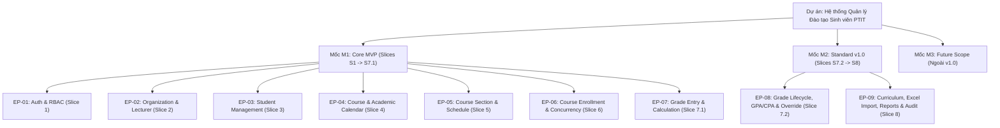

# GIAI ĐOẠN 7: PRODUCT BACKLOG CHI TIẾT & MA TRẬN TRUY VẾT (TRACEABILITY MATRIX)

> [!NOTE]
> Tài liệu này thực hiện mục **10.2 (Product Backlog)** và **Ma trận truy vết (Traceability Matrix)** của [Planning.md](file:///f:/QUẢN-LÝ-SINH-VIÊN-2/Planning.md#L938-L960), tổ chức công việc theo cấu trúc phân cấp `Project → Epic → Feature → User Story → Task` và phân loại rõ công việc `BA`, `DB`, `BE`, `FE`, `TEST`, `DEVOPS`, `DOC` theo đúng 8 lát cắt dọc (`Slice S1` → `Slice S8`).

---

## 1. CẤU TRÚC PHÂN CẤP PRODUCT BACKLOG (PROJECT → EPIC → FEATURE → USER STORY)

---

## 2. PRODUCT BACKLOG CHI TIẾT THEO TỪNG LÁT CẮT (SLICES S0 → S8)

**Quy ước nhãn loại công việc (`Type`):**
- `BA`: Phân tích & đặc tả nghiệp vụ
- `DB`: Thiết kế Database, viết Migration Flyway, Index, Seed SQL
- `BE`: Lập trình Backend Spring Boot (Entity, Repository, Service, Controller, Security)
- `FE`: Lập trình Frontend Next.js (Page, Form, Table, Hook, Proxy)
- `TEST`: Kiểm thử (Unit Test, Integration Test với Testcontainers, Security Test, E2E Test)
- `DEVOPS`: Docker Compose, CI/CD, cấu hình môi trường
- `DOC`: Tài liệu hóa & hoàn thiện Portfolio

---

### Khởi động & Nền tảng (`EP-00` — Environment & Database Baseline)

| Task ID | Epic / Slice | Tên Task & Subtasks chính | Type | Priority | Size | Phụ thuộc | Tiêu chí nghiệm thu (Acceptance Criteria) | Status |
|---|---|---|---|---|---|---|---|---|
| `T-00.01` | `EP-00` | Hoàn thành bộ tài liệu BA, SRS, UML, ERD, Data Dictionary, API Spec | `BA` / `DOC` | Must | L | — | Đủ tài liệu Giai đoạn 1 → 9 trong thư mục `docs/`, nhất quán 100% | **Done** |
| `T-00.02` | `EP-00` | Khởi tạo Monorepo (`backend/` Spring Boot Maven Java 25, `frontend/` Next.js TS, `docker-compose.yml` PostgreSQL 17 + Mailpit) | `DEVOPS` | Must | S | `T-00.01` | Lệnh `docker compose up -d` khởi chạy PostgreSQL và Mailpit thành công | To Do |
| `T-00.03` | `EP-00` | Thiết lập Flyway Migration `V1__init_schema.sql` và `V2__seed_demo_data.sql` từ file SQL Giai đoạn 4 | `DB` | Must | M | `T-00.02` | Spring Boot khởi động tự động tạo đủ 28 bảng, constraints, indexes và dữ liệu mẫu không lỗi | To Do |
| `T-00.04` | `EP-00` | Xây dựng khung `common` Backend (`ApiResponse`, `GlobalExceptionHandler`, `PageResponse`, cấu hình OpenAPI Swagger) & Next.js Rewrite Proxy `/api/v1/*` | `BE` / `FE` | Must | S | `T-00.03` | Frontend gọi thử `/api/v1/health` qua cổng `3000` nhận phản hồi JSON chuẩn từ Spring Boot | To Do |

---

### Slice 1 (`EP-01` — Authentication, RBAC & Account Management — Mốc M1)
*User Stories liên quan:* `US-ADM-01`, `US-ADM-02` | *FR liên quan:* `FR-AUTH-01` → `06`

| Task ID | Tên Task & Mô tả | Type | Priority | Size | Phụ thuộc | Tiêu chí nghiệm thu (Acceptance Criteria) | Status |
|---|---|---|---|---|---|---|---|
| `T-01.01` | Ánh xạ JPA Entities & Repositories cho `User`, `Role`, `Permission`, `UserRole`, `RolePermission`, `RefreshToken` | `DB` / `BE` | Must | S | `T-00.03` | Truy vấn được User kèm danh sách Role & Permission không bị lỗi `LazyInitializationException` | To Do |
| `T-01.02` | Hiện thực `JwtTokenProvider`, `JwtAuthenticationFilter`, cấu hình `SecurityFilterChain` và `@EnableMethodSecurity` | `BE` | Must | M | `T-01.01` | Giải mã JWT từ `HttpOnly` Cookie, gắn `UserPrincipal` vào `SecurityContext`; trả `401`/`403` chuẩn JSON | To Do |
| `T-01.03` | Hiện thực `AuthService` & `AuthController`: Đăng nhập, Refresh Token Rotation, Đăng xuất, Đổi mật khẩu (`FR-AUTH-01`..`03`) | `BE` | Must | M | `T-01.02` | Mật khẩu băm BCrypt; tài khoản `LOCKED` bị chặn cả lúc login và refresh; đổi mật khẩu thu hồi toàn bộ refresh token cũ | To Do |
| `T-01.04` | Hiện thực API Quản trị tài khoản & khóa tài khoản (`FR-AUTH-05`) + Quản lý Role/Permission (`FR-AUTH-06`) | `BE` | Must | M | `T-01.03` | Admin khóa tài khoản thu hồi ngay Refresh Token của user đó và ghi `AuditLog`; chặn Admin tự khóa chính mình | To Do |
| `T-01.05` | Xây dựng UI Next.js: Trang Đăng nhập (`/login`), Đổi mật khẩu, Layout điều hướng theo 4 vai trò và Màn hình Admin quản lý User/RBAC | `FE` | Must | M | `T-01.03`, `T-01.04` | Đăng nhập điều hướng đúng Dashboard từng vai trò; ẩn menu không có quyền và xử lý tự động refresh token khi nhận `401` | To Do |
| `T-01.06` | Viết Unit & Security Integration Tests cho phân hệ Auth & RBAC | `TEST` | Must | M | `T-01.04` | Pass 100% test đăng nhập đúng/sai, tài khoản bị khóa, hết hạn token, truy cập trái phép giữa các Role (`401`/`403`) | To Do |

---

### Slice 2 (`EP-02` — Organization & Lecturer Management — Mốc M1)
*User Stories liên quan:* `US-AA-01` | *FR liên quan:* `FR-ORG-01` → `04`

| Task ID | Tên Task & Mô tả | Type | Priority | Size | Phụ thuộc | Tiêu chí nghiệm thu (Acceptance Criteria) | Status |
|---|---|---|---|---|---|---|---|
| `T-02.01` | Ánh xạ JPA Entities, Repositories & DTOs cho `Faculty`, `Department`, `Major`, `AcademicClass`, `Lecturer` | `DB` / `BE` | Must | S | `T-01.02` | Ràng buộc khóa ngoại và kiểm tra trùng mã định danh hoạt động đúng | To Do |
| `T-02.02` | Hiện thực CRUD Service & Controller cho Khoa, Bộ môn, Ngành, Lớp hành chính và tạo Giảng viên kèm tài khoản `User` trong 1 Transaction | `BE` | Must | M | `T-02.01` | Tạo Giảng viên tự động sinh `User` có Role `LECTURER`; chặn xóa vật lý danh mục đã có bản ghi con (`BR-07`) | To Do |
| `T-02.03` | Xây dựng UI Quản lý Khoa, Bộ môn, Ngành, Lớp hành chính và Giảng viên cho Phòng đào tạo | `FE` | Must | M | `T-02.02` | Bảng dữ liệu có tìm kiếm/lọc, modal thêm/sửa có validation bằng Zod, thông báo lỗi rõ ràng | To Do |
| `T-02.04` | Kiểm thử API & Transaction tạo Giảng viên | `TEST` | Must | S | `T-02.02` | Nếu trùng email hoặc mã giảng viên thì rollback không tạo bản ghi `users` dư thừa | To Do |

---

### Slice 3 (`EP-03` — Student Profile & Academic Status Lifecycle — Mốc M1)
*User Stories liên quan:* `US-AA-02`, `US-STU-04` | *FR liên quan:* `FR-STU-01` → `03`

| Task ID | Tên Task & Mô tả | Type | Priority | Size | Phụ thuộc | Tiêu chí nghiệm thu (Acceptance Criteria) | Status |
|---|---|---|---|---|---|---|---|
| `T-03.01` | Ánh xạ JPA Entities & Repositories cho `Student` và `StudentStatusHistory` (kèm query khóa dòng `findByUserIdForUpdate`) | `DB` / `BE` | Must | S | `T-02.01` | Hỗ trợ lọc đa tiêu chí (từ khóa, ngành, lớp HC, khóa học, trạng thái học vụ) | To Do |
| `T-03.02` | Hiện thực `StudentService` & `StudentController`: Tạo/sửa sinh viên (tự động tạo `User`), chuyển đổi 5 trạng thái học vụ kèm lịch sử, và API `/students/me` cho sinh viên tự sửa 4 trường liên lạc | `BE` | Must | M | `T-03.01` | Sinh viên chỉ sửa được `phone`, `personalEmail`, `address`, `avatarUrl` của chính mình (`BR-09`); đổi trạng thái bắt buộc có lý do (`BR-08`) | To Do |
| `T-03.03` | Xây dựng UI Quản lý Sinh viên (Phòng đào tạo) và Trang Hồ sơ cá nhân (Sinh viên) | `FE` | Must | M | `T-03.02` | Phòng đào tạo xem được timeline lịch sử trạng thái học vụ; Sinh viên xem hồ sơ và cập nhật liên lạc mượt mà | To Do |
| `T-03.04` | Kiểm thử phân quyền Data-Scope (chống IDOR giữa các sinh viên) và vòng đời trạng thái | `TEST` | Must | S | `T-03.02` | Sinh viên A không thể đọc/sửa hồ sơ của Sinh viên B dưới mọi hình thức | To Do |

---

### Slice 4 (`EP-04` — Course, Prerequisite DAG & Academic Calendar — Mốc M1)
*User Stories liên quan:* `US-AA-03`, `US-AA-05` | *FR liên quan:* `FR-CRS-01`, `FR-CRS-02`, `FR-SEM-01`, `FR-SEM-02`

| Task ID | Tên Task & Mô tả | Type | Priority | Size | Phụ thuộc | Tiêu chí nghiệm thu (Acceptance Criteria) | Status |
|---|---|---|---|---|---|---|---|
| `T-04.01` | Ánh xạ JPA Entities & Repositories cho `Course`, `CoursePrerequisite`, `GradeComponent`, `AcademicYear`, `Semester` | `DB` / `BE` | Must | S | `T-02.01` | Đọc/ghi đầy đủ cấu trúc thành phần điểm và điều kiện học phần | To Do |
| `T-04.02` | Hiện thực `CourseService` + thuật toán kiểm tra tổng trọng số điểm = 100% (`BR-28`) và thuật toán duyệt đồ thị DFS chặn chu trình tiên quyết (`BR-12`) | `BE` | Must | M | `T-04.01` | Báo lỗi `400` khi tổng trọng số `!= 100%` hoặc khi thiết lập tiên quyết tạo vòng lặp `A → B → A` | To Do |
| `T-04.03` | Hiện thực `SemesterService` quản lý Năm học, Học kỳ, giới hạn tín chỉ (`min_credits`, `max_credits`) và đóng/mở đợt đăng ký (`FR-SEM-01`, `FR-SEM-02`) | `BE` | Must | S | `T-04.01` | Cập nhật tức thì trạng thái mở/đóng đợt đăng ký và khung giờ hiệu lực | To Do |
| `T-04.04` | Xây dựng UI Quản lý Học phần (kèm cấu hình đầu điểm & môn tiên quyết) và UI Quản lý Năm học / Học kỳ / Đợt đăng ký | `FE` | Must | M | `T-04.02`, `T-04.03` | Form thêm thành phần điểm tự động tính tổng % trực tiếp trên giao diện | To Do |
| `T-04.05` | Unit Test thuật toán phát hiện chu trình đồ thị tiên quyết và kiểm tra trọng số điểm | `TEST` | Must | S | `T-04.02` | Bao phủ các trường hợp chu trình trực tiếp (`A ↔ B`) và chu trình bắc cầu (`A → B → C → A`) | To Do |

---

### Slice 5 (`EP-05` — Course Section, Classroom & Schedule Conflict Detection — Mốc M1)
*User Stories liên quan:* `US-AA-04`, `US-LEC-01` | *FR liên quan:* `FR-SEC-01` → `03`, `FR-SCH-01`, `FR-SCH-02`

| Task ID | Tên Task & Mô tả | Type | Priority | Size | Phụ thuộc | Tiêu chí nghiệm thu (Acceptance Criteria) | Status |
|---|---|---|---|---|---|---|---|
| `T-05.01` | Ánh xạ JPA Entities & Repositories cho `Classroom`, `CourseSection`, `SectionSchedule` (kèm `@Lock(PESSIMISTIC_WRITE)` trên `CourseSection`) | `DB` / `BE` | Must | S | `T-04.01` | Truy vấn nhanh danh sách ca học theo học kỳ, phòng học và giảng viên | To Do |
| `T-05.02` | Hiện thực `ScheduleConflictValidator` và `CourseSectionService`: kiểm tra sức chứa phòng học, trùng lịch Phòng học (`BR-16`) và trùng lịch Giảng viên (`BR-17`) theo công thức giao đoạn Tuần & Tiết (`BR-15`) | `BE` | Must | L | `T-05.01` | Chặn chính xác mọi trường hợp giao tiết/tuần của cùng Phòng học hoặc cùng Giảng viên trong học kỳ | To Do |
| `T-05.03` | Hiện thực API tra cứu Lớp học phần mở, xem danh sách SV trong lớp (kiểm tra Data-Scope cho Giảng viên) và API Thời khóa biểu cá nhân (`/schedules/me`) | `BE` | Must | M | `T-05.02` | Giảng viên chỉ xem được danh sách SV của lớp mình phụ trách (`403` nếu truy cập lớp người khác) | To Do |
| `T-05.04` | Xây dựng UI Quản lý Phòng học, Mở Lớp học phần & Xếp lịch (Phòng đào tạo) và UI Xem danh sách lớp phân công (Giảng viên) | `FE` | Must | M | `T-05.02`, `T-05.03` | Hiển thị rõ thông báo lớp/phòng/tiết bị trùng khi xếp lịch xung đột | To Do |
| `T-05.05` | Viết Unit & Integration Test cho thuật toán kiểm tra trùng lịch Phòng học và Giảng viên | `TEST` | Must | M | `T-05.02` | Kiểm thử các trường hợp biên: chạm đầu mút tiết (`1–3` và `3–5` → trùng; `1–3` và `4–6` → không trùng; khác khoảng tuần → không trùng) | To Do |

---

### Slice 6 (`EP-06` — Course Enrollment, Cancellation & Concurrency Control — Trọng tâm Mốc M1)
*User Stories liên quan:* `US-STU-01`, `US-STU-02`, `US-AA-06` | *FR liên quan:* `FR-ENR-01` → `03`

| Task ID | Tên Task & Mô tả | Type | Priority | Size | Phụ thuộc | Tiêu chí nghiệm thu (Acceptance Criteria) | Status |
|---|---|---|---|---|---|---|---|
| `T-06.01` | Ánh xạ JPA Entity & Repository cho `Enrollment` (kèm truy vấn kiểm tra tiên quyết, tính tổng tín chỉ học kỳ và lịch học đã đăng ký) | `DB` / `BE` | Must | M | `T-05.01` | Partial Unique Index `uq_enrollments_active_course_semester` hoạt động đúng trên PostgreSQL | To Do |
| `T-06.02` | Hiện thực `EnrollmentService.enrollStudent()` trong `@Transactional`: khóa dòng theo thứ tự `Student → CourseSection (FOR UPDATE)`, kiểm tra đủ 7 điều kiện (`BR-19` → `BR-25`), tính `attempt_number` học lại/cải thiện và tăng `current_enrolled` | `BE` | Must | L | `T-06.01` | Đảm bảo tính nguyên tử ACID và trả về đúng mã lỗi nghiệp vụ cho từng điều kiện vi phạm | To Do |
| `T-06.03` | Hiện thực `EnrollmentService.cancelStudentEnrollment()` (`BR-26`) và `overrideEnrollment()` cho Phòng đào tạo đăng ký/hủy hộ có ghi `AuditLog` (`FR-ENR-02`, `FR-ENR-03`) | `BE` | Must | M | `T-06.02` | Hủy đăng ký đổi trạng thái sang `CANCELLED` (không xóa vật lý) và hoàn lại 1 suất trống (`current_enrolled - 1`) | To Do |
| `T-06.04` | Xây dựng UI Đăng ký học phần & Hủy đăng ký cho Sinh viên + UI Đăng ký/Hủy hộ cho Phòng đào tạo | `FE` | Must | L | `T-06.02`, `T-06.03` | Hiển thị trực quan sĩ số `current/max`, tổng số tín chỉ đã đăng ký trong kỳ và thông báo lỗi chi tiết khi bị chặn | To Do |
| `T-06.05` | **Kiểm thử đồng thời (Concurrency Integration Test với Testcontainers PostgreSQL):** Giả lập 20 luồng đồng thời cùng đăng ký vào lớp học phần chỉ còn 1 suất trống cuối cùng (`49/50`) | `TEST` | Must | M | `T-06.02` | Đúng **1** luồng thành công (`201`), **19** luồng nhận `409 ENROLL_SECTION_FULL`, `current_enrolled` sau cùng bằng đúng `50` (không bao giờ lên `51`) | To Do |

---

### Slice 7 (`EP-07` & `EP-08` — Grade Management, Lifecycle & GPA/CPA Calculation — Mốc M1 & M2)
*User Stories liên quan:* `US-LEC-02`, `US-LEC-03`, `US-AA-07`, `US-STU-03` | *FR liên quan:* `FR-GRD-01` → `05`

| Task ID | Tên Task & Mô tả | Type | Priority | Size | Phụ thuộc | Tiêu chí nghiệm thu (Acceptance Criteria) | Status |
|---|---|---|---|---|---|---|---|
| `T-07.01` | Ánh xạ JPA Entities & Repositories cho `StudentGrade`, `GradingScale`, `SystemConfig` | `DB` / `BE` | Must | S | `T-06.01` | Đọc bảng quy đổi thang điểm và cấu hình quy chế từ DB | To Do |
| `T-07.02` | Hiện thực `GradeCalculatorDomainService`: tính `final_score_10` theo trọng số (làm tròn 1 chữ số thập phân), xét điểm liệt cuối kỳ (`< 4.0` → `F / 0.0`), đối chiếu `GradingScale` và tính GPA học kỳ / CPA tích lũy (lấy điểm cao nhất khi học lại `BR-31`) | `BE` | Must | M | `T-07.01` | Tính chính xác 100% các ca biên (điểm liệt cuối kỳ, làm tròn `8.45 → 8.5`, học lại môn trượt `F` lên `B`) | To Do |
| `T-07.03` | Hiện thực `GradeService`: Giảng viên nhập/lưu điểm nháp (`DRAFT`), Công bố điểm (`PUBLISHED`), Phòng đào tạo khóa sổ điểm (`LOCKED`) và sửa điểm sau khóa kèm lý do + `AuditLog` (`BR-30`) | `BE` | Must | M | `T-07.02` | Chặn Giảng viên sửa điểm lớp không phụ trách (`403`) hoặc lớp đã `PUBLISHED`/`LOCKED` (`400`); ẩn điểm `DRAFT` với Sinh viên | To Do |
| `T-07.04` | Xây dựng UI Nhập & Công bố điểm cho Giảng viên, UI Khóa/Điều chỉnh điểm cho Phòng đào tạo và UI Tra cứu Bảng điểm + GPA/CPA cho Sinh viên | `FE` | Must | L | `T-07.03` | Lưới nhập điểm tiện lợi, tự động hiển thị điểm tổng kết sau khi lưu; bảng điểm Sinh viên hiển thị rõ GPA từng kỳ và CPA tích lũy | To Do |
| `T-07.05` | Viết Unit Test & Integration Test cho toàn bộ công thức tính điểm, điểm liệt, quy trình 3 trạng thái và GPA/CPA học lại | `TEST` | Must | M | `T-07.03` | Pass toàn bộ test case tính điểm và bảo mật phân quyền điểm | To Do |

---

### Slice 8 (`EP-09` — Curriculum, Grid Timetable UI, Excel Import, Reports & Audit Log — Hoàn tất Mốc M2 / v1.0)
*User Stories liên quan:* `US-ADM-03` | *FR liên quan:* `FR-CUR-01`, `FR-CUR-02`, `FR-STU-04`, `FR-GRD-02`, `FR-RPT-01`, `FR-SYS-01`, `FR-SYS-02`, `FR-AUTH-04`

| Task ID | Tên Task & Mô tả | Type | Priority | Size | Phụ thuộc | Tiêu chí nghiệm thu (Acceptance Criteria) | Status |
|---|---|---|---|---|---|---|---|
| `T-08.01` | Hiện thực Backend & UI Quản lý Chương trình đào tạo (`Curriculum`) và Màn hình theo dõi tiến độ hoàn thành CTĐT của Sinh viên (`FR-CUR-01`, `FR-CUR-02`) | `BE` / `FE` | Should | M | `T-07.03` | Hiển thị rõ môn Đã đạt / Đang học / Chưa đạt / Chưa học và tiến độ tín chỉ tích lũy | To Do |
| `T-08.02` | Xây dựng Giao diện Thời khóa biểu dạng lưới trực quan (Thứ 2 → Thứ 7 × 12 Tiết) có lọc theo Tuần học cho Sinh viên và Giảng viên | `FE` | Should | M | `T-05.03` | Hiển thị rõ ca học trên lưới 12 tiết và responsive trên Mobile/Tablet | To Do |
| `T-08.03` | Hiện thực chức năng Import CSV/Excel (Validate & Preview + All-or-Nothing) cho Hồ sơ Sinh viên (`FR-STU-04`) và Bảng điểm Lớp học phần (`FR-GRD-02`) | `BE` / `FE` | Should | M | `T-03.02`, `T-07.03` | Nếu file có 1 dòng lỗi thì trả về danh sách dòng lỗi cụ thể và không lưu nửa vời vào DB (`BR-32`) | To Do |
| `T-08.04` | Hiện thực Quên mật khẩu & Đặt lại mật khẩu qua Email với Mailpit/SMTP (`FR-AUTH-04`) | `BE` / `FE` | Should | S | `T-01.03` | Nhận được email đặt lại mật khẩu trên giao diện Mailpit (`:8025`) và đặt lại mật khẩu thành công | To Do |
| `T-08.05` | Hiện thực 4 Báo cáo thống kê đào tạo (`FR-RPT-01`), Màn hình cấu hình Thang điểm (`FR-SYS-01`) và Màn hình tra cứu Audit Log (`FR-SYS-02`) | `BE` / `FE` | Should | M | `T-07.03` | Biểu đồ thống kê quân số, tỷ lệ lấp đầy lớp, phổ điểm và tra cứu chi tiết `old_value_json` / `new_value_json` trong Audit Log | To Do |
| `T-08.06` | Hoàn thiện README, ảnh chụp màn hình, tài liệu Portfolio và kiểm thử hệ thống tổng thể (Gate G5 – Release v1.0) | `TEST` / `DOC` | Must | M | `T-08.01`..`05` | Đạt 100% tiêu chí nghiệm thu của Giai đoạn 8 & Giai đoạn 9 | To Do |

---

## 3. MA TRẬN TRUY VẾT TOÀN HỆ THỐNG — TRACEABILITY MATRIX

Bảng dưới đây đảm bảo **không có bất kỳ yêu cầu nghiệp vụ nào bị bỏ sót hoặc lệch nhau** từ Business Rule → Functional Requirement → Use Case → Database Table → REST API → Task Backlog → Test Case:

| Business Rules (`BR`) | Functional Req (`FR`) | Use Case (`UC`) | Bảng Database (`PostgreSQL`) | Endpoint API chính | Backlog Task | Test Cases (`TC` – GĐ8) |
|---|---|---|---|---|---|---|
| `BR-01`, `BR-02`, `BR-03` | `FR-AUTH-01` → `06` | `UC-AUTH-01` → `07`, `UC-RBAC-01` → `06` | `users`, `roles`, `permissions`, `user_roles`, `role_permissions`, `refresh_tokens` | `/api/v1/auth/*`, `/api/v1/admin/users/*`, `/api/v1/admin/roles/*` | `T-01.01` → `T-01.06` | `TC-AUTH-01` → `TC-AUTH-06` |
| `BR-04`, `BR-05`, `BR-06`, `BR-07` | `FR-ORG-01` → `04` | `UC-ORG-01`, `UC-ORG-02` | `faculties`, `departments`, `majors`, `academic_classes`, `lecturers` | `/api/v1/faculties`, `/api/v1/departments`, `/api/v1/majors`, `/api/v1/academic-classes`, `/api/v1/lecturers` | `T-02.01` → `T-02.04` | `TC-ORG-01` → `TC-ORG-03` |
| `BR-04`, `BR-05`, `BR-08`, `BR-09`, `BR-32` | `FR-STU-01` → `04` | `UC-STU-01` → `05` | `students`, `student_status_history`, `users` | `/api/v1/students`, `/api/v1/students/me/contact`, `/api/v1/students/import` | `T-03.01` → `T-03.04`, `T-08.03` | `TC-STU-01` → `TC-STU-05` |
| `BR-10`, `BR-11`, `BR-12`, `BR-28` | `FR-CRS-01`, `FR-CRS-02` | `UC-CRS-01` → `03` | `courses`, `course_prerequisites`, `grade_components` | `/api/v1/courses`, `/api/v1/courses/{id}/prerequisites` | `T-04.01`, `T-04.02`, `T-04.05` | `TC-CRS-01` → `TC-CRS-03` |
| `BR-13` | `FR-CUR-01`, `FR-CUR-02` | `UC-CUR-01`, `UC-CUR-02` | `curriculums`, `curriculum_courses` | `/api/v1/curriculums`, `/api/v1/students/me/curriculum-progress` | `T-08.01` | `TC-CUR-01` |
| `BR-14` → `BR-18`, `BR-20`, `BR-23` | `FR-SEM-01`, `FR-SEM-02`, `FR-SEC-01` → `03`, `FR-SCH-01`, `FR-SCH-02` | `UC-SEM-01`, `UC-SEM-02`, `UC-SEC-01` → `04`, `UC-SCH-01` | `academic_years`, `semesters`, `classrooms`, `course_sections`, `section_schedules` | `/api/v1/semesters`, `/api/v1/classrooms`, `/api/v1/sections`, `/api/v1/schedules/me` | `T-04.03`, `T-05.01` → `T-05.05`, `T-08.02` | `TC-SEC-01` → `TC-SEC-04` |
| `BR-15`, `BR-19` → `BR-27`, `BR-32` | `FR-ENR-01` → `03` | `UC-ENR-01` → `04` | `enrollments`, `course_sections`, `students`, `audit_logs` | `/api/v1/enrollments`, `/api/v1/enrollments/override` | `T-06.01` → `T-06.05` | `TC-ENR-01` → `TC-ENR-10` |
| `BR-03`, `BR-28` → `BR-32` | `FR-GRD-01` → `05` | `UC-GRD-01` → `08` | `student_grades`, `enrollments`, `course_sections`, `grading_scales`, `system_configs`, `audit_logs` | `/api/v1/sections/{id}/grades/*`, `/api/v1/students/me/academic-results` | `T-07.01` → `T-07.05`, `T-08.03` | `TC-GRD-01` → `TC-GRD-08` |
| `BR-32` | `FR-RPT-01`, `FR-SYS-01`, `FR-SYS-02` | `UC-RPT-01`, `UC-RBAC-05` | `audit_logs`, `grading_scales`, `system_configs` | `/api/v1/reports/*`, `/api/v1/admin/audit-logs`, `/api/v1/system-configs/*` | `T-08.05` | `TC-SYS-01`, `TC-SYS-02` |
