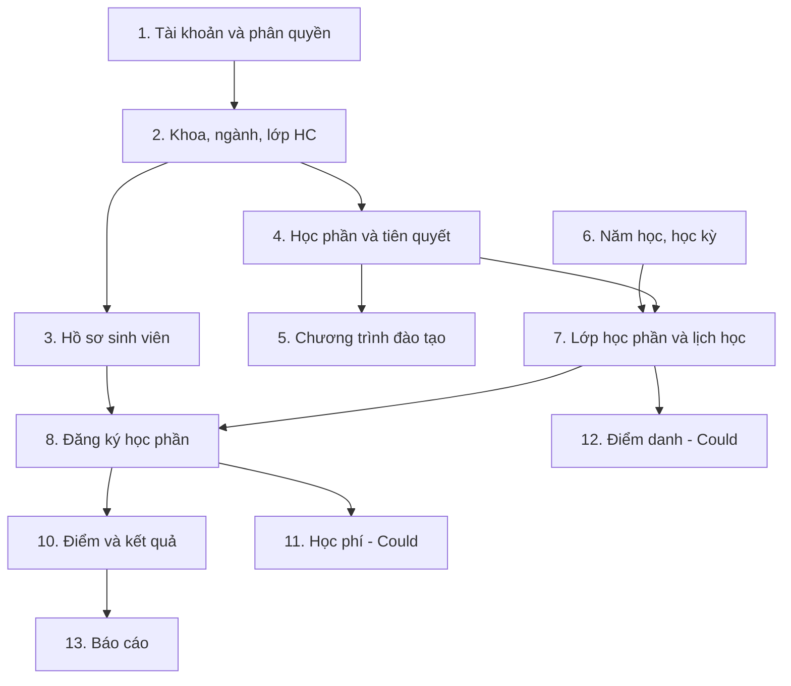

# KẾ HOẠCH TỔNG THỂ — WEBSITE QUẢN LÝ ĐÀO TẠO SINH VIÊN PTIT

> [!NOTE]
> **Phiên bản v1.0 (Baseline)** — đã hoàn tất cả 3 vòng khảo sát và chốt toàn bộ 24 quyết định (`D-01` → `D-24`). Bản kế hoạch này là cơ sở để triển khai các giai đoạn tiếp theo.

**Ký hiệu trạng thái:**

| Nhãn | Ý nghĩa |
|---|---|
| ✅ **Confirmed** | Bạn đã xác nhận (hoặc đã ghi rõ trong `Planning.md`) |
| 💡 **Proposed** | Tôi đề xuất, chờ bạn duyệt |
| ⚠️ **Assumption** | Giả định để thiết kế tiếp, chưa có tài liệu xác thực |
| ❓ **Open Question** | Chưa được giải quyết |

---

## 1. Nhật ký quyết định (Decision Log)

| ID | Quyết định | Trạng thái | Hệ quả |
|---|---|---|---|
| D-01 | Chốt DBMS trước bước Physical Data Model; Entity, Conceptual và Logical vẫn độc lập với DBMS | ✅ Confirmed | Đã thực hiện qua D-04 (PostgreSQL) |
| D-02 | Phát triển theo **lát cắt dọc** (mỗi phân hệ làm trọn DB + API + UI + test) | ✅ Confirmed | Backlog vẫn gắn nhãn BA/DB/BE/FE/TEST |
| D-03 | **Không** lập timeline/deadline theo tuần | ✅ Confirmed | Tiến độ đo bằng **mốc chức năng** (M1/M2/M3) và Gate, không đo bằng ngày |
| D-04 | Tech stack: **Java Spring Boot + Next.js + PostgreSQL** | ✅ Confirmed | Phase chọn tech stack chỉ còn ghi lại lý do (ADR) và chốt các quyết định con (mục 5) |
| D-05 | **Không có quy chế đào tạo thật** | ✅ Confirmed | Mọi quy tắc nghiệp vụ ghi ⚠️ Assumption, dữ liệu là giả lập; các tham số quan trọng phải **cấu hình được** (xem 1.1) |
| D-06 | Mục tiêu v1.0 là **M2 (Standard)**, phát hành M1 (Core) trước | ✅ Confirmed | Backlog ưu tiên hoàn thành M1 rồi mới làm phần M2 |
| D-07 | Actor MVP: **Admin, Phòng đào tạo, Giảng viên, Sinh viên**. **Không** có Cố vấn học tập | ✅ Confirmed | Cố vấn học tập, Cán bộ khoa, Người xem báo cáo → Won't (v1). Thiết kế RBAC vẫn cho phép thêm vai trò sau mà không sửa schema |
| D-08 | **Chưa deploy** ở giai đoạn này; phát triển và demo trên máy cá nhân bằng Docker Compose | ✅ Confirmed | Hoãn chọn hosting và P9 tới sau Gate G4. README phải đủ để người khác chạy được trên máy của họ |
| D-09 | Sinh viên **tự đăng ký** trong đợt do Phòng đào tạo mở; Phòng đào tạo được **đăng ký/hủy hộ** (bắt buộc ghi log); **không có danh sách chờ** trong MVP | ✅ Confirmed | Cần lưu "ai thao tác" trên mỗi lượt đăng ký/hủy; danh sách chờ → Could (M3) |
| D-10 | **Cho phép học lại / học cải thiện**; GPA lấy **lần điểm cao nhất** | ✅ Confirmed (quy tắc ⚠️ Assumption, cấu hình được) | Dữ liệu phải lưu **mọi lần học** của một học phần, không ghi đè kết quả cũ |
| D-11 | Điều kiện học phần hỗ trợ **2 loại**: `PREREQUISITE` (Tiên quyết – phải qua môn, điểm ≥ D) và `COREQUISITE` (Học trước – đã từng đăng ký và có điểm tổng kết). Không làm "song hành" ở MVP | ✅ Confirmed (⚠️ Assumption) | Bảng `course_prerequisites` có cột `condition_type`; tránh phụ thuộc vòng khi hủy môn |
| D-12 | Giới hạn tín chỉ cấu hình theo từng học kỳ (giả lập: kỳ chính `12–24`, kỳ hè tối đa `9`). Khi đăng ký: chặn ngay nếu vượt **tối đa**; mức **tối thiểu** chỉ cảnh báo/kiểm tra khi chốt đợt | ✅ Confirmed (⚠️ Assumption) | Tránh lỗi logic chặn sinh viên khi đăng ký môn đầu tiên |
| D-13 | Sinh viên chỉ tự hủy đăng ký **trong thời gian mở đợt đăng ký**; sau đó chỉ Phòng đào tạo được hủy hộ (có lý do). Khi hủy đổi trạng thái sang `CANCELLED` (không `DELETE` vật lý) và hoàn lại 1 suất trống | ✅ Confirmed (⚠️ Assumption) | Giữ lịch sử Audit và hoàn suất an toàn trong Transaction |
| D-14 | Thành phần điểm cấu hình linh hoạt theo môn (mặc định giả lập: Chuyên cần 10%, KT/TH 20%, Giữa kỳ 20%, Cuối kỳ 50%; tổng = 100%; điểm liệt cuối kỳ `< 4.0`) | ✅ Confirmed (⚠️ Assumption) | Thiết kế bảng `grade_components` thay vì cột cứng |
| D-15 | Hệ 10 làm tròn 1 chữ số thập phân, GPA hệ 4 làm tròn 2 chữ số thập phân; thang quy đổi `A (4.0), B+ (3.5), B (3.0), C+ (2.5), C (2.0), D+ (1.5), D (1.0), F (0.0)` lưu trong DB; qua môn từ `D (1.0)` | ✅ Confirmed (⚠️ Assumption) | Bảng `grading_scale` tách quy tắc quy đổi khỏi code |
| D-16 | Quy trình điểm 3 trạng thái: `DRAFT` (GV nhập, SV chưa thấy) → `PUBLISHED` (SV xem được, GV không tự sửa được) → `LOCKED` (PĐT khóa sổ). Sửa sau khi công bố/khóa chỉ do PĐT thực hiện kèm lý do trong Audit Log | ✅ Confirmed | Ràng buộc rõ State Diagram và quyền giữa Giảng viên / Phòng đào tạo |
| D-17 | Trạng thái học vụ của sinh viên gồm 5 trạng thái (`ACTIVE`, `ON_LEAVE`, `SUSPENDED`, `GRADUATED`, `DROPPED_OUT`). Chỉ `ACTIVE` mới được đăng ký học phần; các trạng thái khác vẫn đăng nhập xem điểm được | ✅ Confirmed | Tách biệt `User.status` (tài khoản) và `Student.academic_status` (học vụ) |
| D-18 | Sinh viên chỉ tự sửa được thông tin liên lạc (SĐT, email cá nhân, địa chỉ, ảnh đại diện); thông tin pháp lý & học vụ chỉ Phòng đào tạo được sửa | ✅ Confirmed | Tách DTO/API riêng cho Sinh viên tự cập nhật và Phòng đào tạo quản lý |
| D-19 | Một ngày chia **12 tiết** (Tiết 1–6 sáng, 7–10 chiều, 11–12 tối), học Thứ 2 → Thứ 7. Lịch học gồm `(thứ, tiết_bắt_đầu, tiết_kết_thúc, tuần_bắt_đầu, tuần_kết_thúc, phòng_học)`. Kiểm tra trùng lịch trên cả **3 chiều**: Sinh viên, Giảng viên, Phòng học | ✅ Confirmed (⚠️ Assumption) | Kiểm tra giao đoạn `[start1, end1]` và `[start2, end2]` cho cả tuần và tiết |
| D-20 | Quy ước mã giả lập theo phong cách PTIT: Mã SV `B22DCCN001`, Mã môn `INT1306`, Mã lớp HC `D22CQCN01-B`, Mã lớp học phần `INT1306-20261-01` | ✅ Confirmed (⚠️ Assumption) | Dùng cho dữ liệu mẫu và gợi ý định dạng, vẫn cho phép PĐT nhập mã hợp lệ khác |
| D-21 | Giữ thực thể **Bộ môn (`Department`)** thuộc Khoa (`Faculty`): Khoa quản lý Ngành (`Major`) và Bộ môn (`Department`); Giảng viên và Học phần thuộc Bộ môn | ✅ Confirmed | Khớp mục 7.1 `Planning.md` và phản ánh đúng cơ cấu tổ chức đại học |
| D-22 | Ở mốc M2, hỗ trợ import **CSV/Excel (.xlsx)** cho: (1) danh sách hồ sơ sinh viên, (2) bảng điểm lớp học phần. Có bước **Validate & Preview** và nguyên tắc **All-or-Nothing** (lỗi 1 dòng thì báo chi tiết và rollback toàn bộ file) | ✅ Confirmed | Đảm bảo toàn vẹn dữ liệu khi nhập hàng loạt |
| D-23 | Cơ chế xác thực: **JWT Access Token (15 phút) + Refresh Token (7 ngày, lưu hash trong DB)** đặt trong `HttpOnly` Cookie, kết hợp proxy `/api/*` của Next.js; thu hồi Refresh Token ngay khi khóa tài khoản/đổi mật khẩu/đăng xuất | ✅ Confirmed | Chống XSS đọc token, hỗ trợ thu hồi phiên tức thì |
| D-24 | Giao diện **Tiếng Việt**; code/DB/API **Tiếng Anh**; UI dùng `shadcn/ui` + Tailwind CSS; **Desktop-first** cho quản trị và **Responsive Mobile/Tablet** cho màn hình Sinh viên | ✅ Confirmed | Tối ưu tốc độ phát triển cá nhân và trải nghiệm demo |

### 1.1. Nguyên tắc thiết kế rút ra từ D-05

Vì không có quy chế thật, quy tắc nào có khả năng khác nhau giữa các trường thì **không viết cứng trong code** mà lưu thành tham số (theo học kỳ hoặc toàn hệ thống). Ví dụ:

- Số tín chỉ tối thiểu/tối đa mỗi học kỳ.
- Thời gian mở/đóng đợt đăng ký và hạn hủy đăng ký.
- Thành phần điểm và trọng số của từng học phần.
- Bảng quy đổi điểm 10 → điểm chữ → điểm 4.
- Cách tính điểm khi học lại (lấy điểm cao nhất hay lần gần nhất).

**Lợi ích cho Portfolio:** khi phỏng vấn, bạn giải thích được rằng hệ thống tách *quy tắc* khỏi *dữ liệu cấu hình*, nên áp dụng được cho quy chế khác mà không phải sửa code. Lưu ý không làm quá đà: chỉ cấu hình hóa những quy tắc có trong danh sách Business Rules, không xây "rule engine" tổng quát.

---

## 2. Tóm tắt dự án

| Hạng mục | Nội dung | Trạng thái |
|---|---|---|
| Tên dự án | Hệ thống quản lý đào tạo sinh viên PTIT | ✅ |
| Mục đích | Portfolio ứng tuyển Software / Backend / Fullstack Developer | ✅ |
| Nhân sự | 1 người, trình độ Intern/Fresher | ✅ |
| Tech stack | Spring Boot (backend) · Next.js (frontend) · PostgreSQL | ✅ |
| Trọng tâm | Database (ưu tiên cao nhất), UML, Auth/RBAC, đăng ký học phần có transaction và xử lý đồng thời | ✅ |
| Kiến trúc | Modular Monolith, không Microservices | ✅ định hướng, 💡 chi tiết ở P2c |
| Quy chế | Giả lập, cấu hình được | ✅ |
| Actor | Admin, Phòng đào tạo, Giảng viên, Sinh viên | ✅ |
| Phạm vi v1.0 | M2 (Standard), phát hành M1 trước | ✅ |
| Deploy | Chưa deploy; chạy trên máy cá nhân bằng Docker Compose | ✅ |
| Dữ liệu | Chỉ dùng dữ liệu giả lập | ✅ |

---

## 3. Khó khăn chính và rủi ro

### 3.1. Khó khăn

1. **Quy tắc nghiệp vụ phụ thuộc lẫn nhau.** Đăng ký học phần chạm tới tiên quyết, tín chỉ, trùng lịch, sĩ số, đợt đăng ký và học lại cùng lúc.
2. **Không có khách hàng thật và không có quy chế thật.** Rất dễ biến giả định thành yêu cầu.
3. **Dữ liệu có tính lịch sử.** Chương trình đào tạo đổi theo khóa, trạng thái sinh viên đổi theo thời gian, điểm bị sửa sau khi công bố.
4. **Xử lý đồng thời.** Nhiều sinh viên tranh suất cuối của cùng một lớp.
5. **Phân quyền hai lớp.** Ngoài RBAC (vai trò → quyền) còn cần phân quyền theo **phạm vi dữ liệu**: giảng viên chỉ thao tác với lớp mình dạy, sinh viên chỉ xem dữ liệu của mình.
6. **Giữ nhất quán giữa nhiều tài liệu**, từ BRD đến SQL và Test Case.
7. **Hai framework lớn cùng lúc.** Spring Security và Next.js App Router đều cần thời gian học.

### 3.2. Rủi ro và cách giảm thiểu

| # | Rủi ro | Mức độ | Cách giảm thiểu (💡 Proposed) |
|---|---|---|---|
| R1 | Scope creep: thêm học phí, điểm danh… trước khi phần lõi chạy được | Cao | MoSCoW + 3 mốc; ý tưởng mới đưa vào backlog Future |
| R2 | Phân tích quá lâu, chậm bắt đầu code | Cao | Mỗi Gate có checklist "đủ dùng"; tài liệu được phép cập nhật lại khi code |
| R3 | Lệch giữa ERD, Data Dictionary, SQL và code | Cao | ID truy vết; **file migration Flyway là nguồn sự thật duy nhất của schema**; đối chiếu ERD với schema trước mỗi mốc |
| R4 | Học Spring Security và Next.js chậm | Cao | Làm prototype nhỏ trước P4; dùng Next.js chủ yếu như ứng dụng quản trị gọi API, chưa dùng các tính năng nâng cao |
| R5 | Đăng ký học phần sai khi có nhiều yêu cầu đồng thời | Trung bình | Thiết kế transaction và khóa ngay ở P3; test đồng thời trên PostgreSQL thật bằng Testcontainers |
| R6 | Lỗ hổng phân quyền (chỉ ẩn nút ở UI) | Trung bình | Kiểm tra quyền ở backend trên từng API; bộ test phân quyền bắt buộc |
| R7 | Lỗi cookie/CORS khi Next.js và Spring Boot chạy khác domain | Trung bình | Dùng **cơ chế proxy (rewrites) của Next.js** để trình duyệt chỉ thấy một origin (quyết định chốt ở P2c) |
| R8 | Logic nghiệp vụ bị rải sang Next.js | Trung bình | Quy ước: **mọi nghiệp vụ và kiểm tra quyền nằm ở Spring Boot**; Next.js chỉ hiển thị và kiểm tra dữ liệu nhập cho trải nghiệm người dùng |
| R9 | Tài liệu không theo kịp code | Cao | Cập nhật tài liệu là một mục trong Definition of Done của mỗi lát cắt |
| R10 | Mất động lực vì dự án dài | Cao | Mỗi mốc là một bản demo được; lát cắt dọc giúp luôn có sản phẩm chạy |

---

## 4. Lộ trình thực hiện

```mermaid
flowchart LR
    P1["P1 Discovery và Requirement<br/>GĐ1 + GĐ2"] --> G1{{"Gate G1<br/>Baseline yêu cầu"}}
    G1 --> P2a["P2a UML và System Design<br/>GĐ3"]
    P2a --> P2b["P2b ADR Tech Stack<br/>GĐ5"]
    P2b --> P3["P3 Database Design<br/>GĐ4 - PostgreSQL"]
    P3 --> G3{{"Gate G3<br/>Baseline dữ liệu"}}
    G3 --> P2c["P2c Architecture và API<br/>GĐ6"]
    P2c --> G2{{"Gate G2<br/>Baseline thiết kế"}}
    G2 --> P4["P4 Environment Setup"]
    P4 --> P567["P5-P7 Lát cắt dọc<br/>Spring Boot + Next.js"]
    P567 --> G4{{"Gate G4<br/>Đủ chức năng MVP"}}
    G4 --> P8["P8 Testing"]
    P8 --> P9["P9 Deployment"]
    P9 --> P10["P10 Portfolio Docs"]
    P10 --> G5{{"Gate G5<br/>Release v1.0"}}
```



> [!NOTE]
> Theo D-03, cột "Quy mô" dưới đây chỉ so sánh **độ lớn tương đối** giữa các phase (S < M < L < XL) để biết phase nào cần đầu tư nhiều. Đây không phải deadline.

| Phase | Mục tiêu | Task chính | Deliverables | Phụ thuộc | Quy mô | Tiêu chí nghiệm thu |
|---|---|---|---|---|---|---|
| **P1** Discovery & Requirement | Chốt phạm vi MVP và đặc tả yêu cầu | Các vòng khảo sát; Actor, phân hệ, MoSCoW; FR, NFR, User Story, Permission Matrix | Project Overview, Stakeholder Analysis, Scope, BRD, Actor list, Business Rules, Open Questions, FR, NFR, User Stories, Permission Matrix | — | L | Mọi Must Have có FR + Acceptance Criteria; không còn Open Question chặn MVP |
| **P2a** UML & System Design | Mô hình hóa hành vi và cấu trúc | Context, Use Case, UC Specification, Activity, Sequence, Class, State, Component, Deployment | Bộ sơ đồ PlantUML/Mermaid kèm source và giải thích | P1 | L | Mỗi Use Case truy vết tới FR; đúng ký hiệu UML; có luồng lỗi |
| **P2b** ADR Tech Stack | Ghi lại lý do chọn stack, chốt quyết định con | Bảng so sánh ngắn (để giải thích trong Portfolio), chốt các mục ở 5.2, prototype nhỏ | ADR-001 Tech Stack + prototype | P1 | S | Prototype: Next.js gọi được 1 API Spring Boot đọc dữ liệu từ PostgreSQL |
| **P3** Database Design | Thiết kế dữ liệu giải thích được | Entity → Conceptual → Logical → Physical (PostgreSQL); ERD; 1NF–3NF; Data Dictionary; Constraint & Index; thiết kế Transaction; SQL, migration, dữ liệu mẫu | Tài liệu DB + script Flyway | P2a, P2b | L | ERD = Data Dictionary = SQL; có thiết kế transaction đăng ký học phần |
| **P2c** Architecture & API | Thiết kế tầng, module, API, bảo mật | Layered + Modular Monolith; API spec; Security design (session/JWT, CSRF, proxy) | Architecture doc, OpenAPI spec, Security design | P3 | M | Mỗi FR có API; mỗi API có quyền khai báo rõ |
| **P4** Environment Setup | Bộ khung chạy được | Monorepo, Docker Compose, Flyway, CI, lint/format, walking skeleton | Repo chạy bằng 1 lệnh; CI xanh | P2c | S | Người khác clone về chạy được theo README |
| **P5–P7** Lát cắt dọc | Hiện thực chức năng | 8 lát cắt ở mục 6.3 | Phần mềm theo từng mốc | P4 | XL | Mỗi lát cắt đạt Definition of Done (8.2) |
| **P8** Testing | Kiểm thử hệ thống | System, security, performance cơ bản, regression, đồng thời | Test Plan, Test Cases, Test Report | P5–P7 | M | Test ưu tiên Cao đạt 100%; không còn lỗi nghiêm trọng |
| **P9** Deployment *(hoãn theo D-08)* | Đưa lên mạng khi bạn cần | Chọn hosting, deploy, HTTPS, dữ liệu demo, backup cơ bản | URL demo + tài khoản theo vai trò | P8 | S | Truy cập công khai được. **Trước khi deploy:** Docker Compose + dữ liệu demo + 4 tài khoản demo chạy được trên máy bất kỳ |
| **P10** Portfolio Docs | Nhà tuyển dụng hiểu dự án nhanh | README, sơ đồ, ảnh chụp, video, kết quả test | Repository hoàn chỉnh | P9 | S | Đủ 17 đầu ra ở mục 12 `Planning.md` |

---

## 5. Tech Stack

### 5.1. Đã chốt (✅ D-04) và lý do tóm tắt

| Thành phần | Lựa chọn | Vì sao phù hợp với dự án này |
|---|---|---|
| Backend | **Java Spring Boot** | Spring Security mạnh cho RBAC và phân quyền theo phạm vi dữ liệu; `@Transactional` + JPA rất hợp nghiệp vụ đăng ký học phần; phổ biến trong tuyển dụng Backend Java tại Việt Nam |
| Frontend | **Next.js (React + TypeScript)** | Hệ sinh thái React lớn, nhiều thư viện bảng/form cho trang quản trị; cơ chế proxy (rewrites) giúp đơn giản hóa xác thực bằng cookie |
| Database | **PostgreSQL** | Ràng buộc mạnh (CHECK, partial unique index, exclusion constraint), transaction và khóa dòng tốt, miễn phí, nhiều nơi hosting miễn phí |

**Trade-off cần biết:** Next.js có nhiều tính năng phía server (Server Components, Server Actions) mà dự án này **không cần cho nghiệp vụ**. Nếu dùng tràn lan, logic sẽ bị chia đôi giữa hai nơi. Vì vậy cần quy ước ở R8.

### 5.2. Các quyết định con còn mở (chốt ở P2b / P2c / P4)

| Quyết định | Đề xuất 💡 | Lý do / ghi chú |
|---|---|---|
| Phiên bản Java | **Java 25 (LTS)** thay vì JDK 26 đang cài | Bản LTS được hỗ trợ lâu dài; JDK 26 là bản ngắn hạn. Sẽ kiểm tra lại độ tương thích với phiên bản Spring Boot ở P2b |
| Spring Boot | Bản ổn định mới nhất (dòng 4.x) | Kiểm tra lại ở P2b |
| Build tool | **Maven** | Dễ đọc với Fresher, tài liệu nhiều; Gradle linh hoạt hơn nhưng không cần thiết |
| Thư viện backend | Spring Web, Spring Security, Spring Data JPA (Hibernate), Bean Validation, **Flyway**, springdoc-openapi | Bộ chuẩn, không thêm thư viện phức tạp |
| Truy vấn báo cáo | JPA cho CRUD; SQL native/JPQL cho truy vấn tổng hợp | Thể hiện kỹ năng viết SQL trong Portfolio |
| Cơ chế xác thực | ✅ JWT Access Token (15 phút) + Refresh Token (7 ngày, lưu hash trong DB) trong `HttpOnly` Cookie (D-23) | Thu hồi được ngay khi khóa tài khoản/đăng xuất; không lưu token ở `localStorage` |
| Kết nối FE–BE | Next.js **rewrites** `/api/*` → Spring Boot | Trình duyệt chỉ thấy một origin, tránh lỗi CORS và cookie khác domain |
| Cách render Next.js | App Router; trang quản trị chủ yếu render ở client; không đặt nghiệp vụ trong Server Actions | Giữ backend là nơi duy nhất xử lý nghiệp vụ |
| UI library | ✅ **shadcn/ui** + Tailwind CSS (D-24) | Hiện đại, nhẹ, kết hợp tốt với TanStack Table và React Hook Form |
| Form & dữ liệu | React Hook Form + Zod; TanStack Query; TanStack Table | Chuẩn phổ biến trong cộng đồng React |
| PostgreSQL | Bản ổn định mới nhất, chạy bằng Docker | |
| Test backend | JUnit 5, Mockito, Spring Boot Test, **Testcontainers (PostgreSQL)** | Test transaction và đồng thời trên DB thật |
| Test frontend | Vitest (unit) + Playwright (E2E cho luồng chính) | Không cần test mọi component |
| CI | GitHub Actions | Build + test cả backend và frontend |
| Hosting | ⏸️ Hoãn tới sau G4 (D-08) | Khi cần: Vercel (Next.js) + Render/Railway (Spring Boot) + Neon/Supabase (PostgreSQL), hoặc Docker Compose trên 1 VPS. Đóng gói bằng Docker ngay từ P4 để sau này deploy dễ |
| Email (quên mật khẩu) | Mailpit khi phát triển; SMTP sandbox khi demo | Không cần dịch vụ trả phí |

---

## 6. Phạm vi MVP (✅ Confirmed)

### 6.1. MoSCoW 13 phân hệ

| # | Phân hệ | Đề xuất | Lý do |
|---|---|---|---|
| 1 | Tài khoản & phân quyền | **Must** | Nền tảng, bắt buộc |
| 2 | Khoa, ngành, lớp hành chính | **Must** (cơ bản) | Sinh viên và học phần thuộc khoa/ngành |
| 3 | Hồ sơ sinh viên | **Must** | Đối tượng trung tâm |
| 4 | Học phần (kèm tiên quyết) | **Must** | Cần cho lớp học phần và điều kiện đăng ký |
| 5 | Chương trình đào tạo | **Should** | Giá trị thiết kế dữ liệu cao, nhưng đăng ký vẫn chạy được nếu chưa có |
| 6 | Năm học, học kỳ, đợt đăng ký | **Must** | Mọi lớp học phần và điểm gắn với học kỳ |
| 7 | Lớp học phần (kèm phân công giảng viên) | **Must** | Đơn vị đăng ký và nhập điểm |
| 8 | Đăng ký học phần | **Must** | Nghiệp vụ có giá trị Portfolio cao nhất |
| 9 | Thời khóa biểu | **Must** phần lịch học (để kiểm tra trùng lịch); **Should** phần giao diện xem dạng lưới | |
| 10 | Điểm & kết quả học tập | **Must** | Nhập, công bố, khóa điểm, tính GPA |
| 11 | Học phí | **Could** | Làm sau M2 |
| 12 | Điểm danh | **Could** | Độc lập, dễ thêm sau |
| 13 | Báo cáo & thống kê | **Should** (cơ bản) | Thể hiện kỹ năng truy vấn tổng hợp |
| — | Lịch thi, phúc khảo, thông báo nâng cao, tích hợp ngoài, SSO | **Won't** | Theo mục 10.3 `Planning.md` |

**Actor (✅ D-07):** Admin · Phòng đào tạo · Giảng viên · Sinh viên. Cố vấn học tập, Cán bộ khoa, Người xem báo cáo → Won't (v1).

### 6.2. Phụ thuộc giữa các phân hệ



### 6.3. Mốc phát hành và các lát cắt

| Mốc | Lát cắt | Nội dung |
|---|---|---|
| **M1 – Core** | S1 | Đăng nhập, đăng xuất, đổi mật khẩu, RBAC, khóa tài khoản |
| | S2 | Khoa, ngành, lớp hành chính, tài khoản giảng viên |
| | S3 | Hồ sơ sinh viên, trạng thái sinh viên |
| | S4 | Học phần, tiên quyết, năm học, học kỳ, đợt đăng ký |
| | S5 | Lớp học phần, phân công giảng viên, phòng học, lịch học |
| | S6 | **Đăng ký / hủy đăng ký**: sĩ số, trùng lịch, chống trùng, đồng thời, tiên quyết |
| | S7 (phần 1) | Nhập điểm, sinh viên xem điểm |
| **M2 – Standard** | S7 (phần 2) | Quy trình công bố/khóa điểm, GPA, bảng điểm |
| | S8 | Chương trình đào tạo, giới hạn tín chỉ, Audit Log, báo cáo cơ bản, quên mật khẩu qua email, import sinh viên từ Excel |
| **M3 – Extended** | — | Học phí, điểm danh, thông báo, lịch thi (chỉ khi M2 hoàn thành tốt) |

---

## 7. Cấu trúc Product Backlog

**Phân cấp:** Project → Epic → Feature → User Story → Task → Subtask. **Nhãn:** `BA` · `DB` · `BE` · `FE` · `TEST` · `DEVOPS` · `DOC`.

| Epic | Tên | Mốc |
|---|---|---|
| EP-01 | Authentication & Authorization | M1 |
| EP-02 | Organization | M1 |
| EP-03 | Student Management | M1 |
| EP-04 | Course & Curriculum | M1 / M2 |
| EP-05 | Academic Calendar | M1 |
| EP-06 | Course Section & Schedule | M1 |
| EP-07 | Enrollment | M1 |
| EP-08 | Grade & Academic Result | M1 / M2 |
| EP-09 | Reporting | M2 |
| EP-10 | Audit & System Configuration (gồm tham số quy chế, D-05) | M2 |
| EP-11 | DevOps & Quality | Xuyên suốt |
| EP-12 | Documentation & Portfolio | Xuyên suốt |
| EP-13…16 | Học phí, Điểm danh, Lịch thi, Thông báo | M3 |

**Mẫu Task:**

| ID | Name | Type | Priority | Size | Dependency | Acceptance Criteria | Status |
|---|---|---|---|---|---|---|---|
| T-07.03 | Kiểm tra sĩ số khi đăng ký | BE | Must | M | T-07.01 | Khi 2 yêu cầu đồng thời tranh 1 suất cuối, đúng 1 yêu cầu thành công, yêu cầu còn lại nhận lỗi "Lớp đã đủ sĩ số"; số đăng ký không vượt sĩ số tối đa | To Do |

**Truy vết:** `BR-xx` → `FR-xx` → `US-xx` → `UC-xx` → bảng DB / API → `TC-xx`, duy trì bằng Traceability Matrix.

---

## 8. Quy trình và tiêu chuẩn chất lượng

### 8.1. Checklist tại mỗi Gate

- [ ] Tổng hợp kết quả giai đoạn.
- [ ] Kiểm tra nhất quán với giai đoạn trước (Traceability Matrix).
- [ ] Liệt kê thông tin còn thiếu / Open Questions mới.
- [ ] Mọi quy tắc đã gắn nhãn Confirmed / Proposed / Assumption.
- [ ] Bạn xác nhận → mới chuyển giai đoạn.

### 8.2. Definition of Done cho mỗi lát cắt

- [ ] Migration Flyway khớp Data Dictionary (cập nhật tài liệu nếu thiết kế thay đổi).
- [ ] API khớp OpenAPI spec, kiểm tra quyền ở Spring Security và validation đầu vào.
- [ ] Unit test cho service; integration test với Testcontainers cho transaction quan trọng.
- [ ] Giao diện Next.js hoàn chỉnh cho các vai trò liên quan, xử lý trạng thái lỗi/loading.
- [ ] Test phân quyền âm (vai trò không được phép nhận 401/403).
- [ ] CI xanh, tự review PR, merge vào `main`.

### 8.3. Git workflow (💡 Proposed)

- **GitHub Flow**: `main` luôn chạy được + nhánh ngắn `feature/*`, `fix/*`, `docs/*`. Không cần nhánh `develop`.
- Tự review qua Pull Request.
- **Conventional Commits**, phạm vi theo module: `feat(enrollment): ...`, `fix(auth): ...`, `docs(db): ...`.
- Tag theo mốc: `v0.1.0` (M1), `v1.0.0` (M2).

```bash
git checkout main && git pull
git checkout -b feature/enrollment-capacity-check
git commit -m "feat(enrollment): lock section row to prevent overbooking"
git push -u origin feature/enrollment-capacity-check
# Tạo PR → tự review → CI xanh → squash merge → xóa nhánh
```

### 8.4. Cấu trúc repository (monorepo)

```text
ptit-training-management/
├── backend/                    # Spring Boot (Maven), chia package theo module nghiệp vụ
├── frontend/                   # Next.js (TypeScript)
├── docs/
│   ├── 00-project-plan/
│   ├── 01-requirements/
│   ├── 02-uml/                 # .puml + ảnh xuất
│   ├── 03-database/            # ERD, Data Dictionary, Normalization, Transaction design
│   ├── 04-architecture/        # Kiến trúc + ADR
│   ├── 05-api/                 # OpenAPI
│   ├── 06-testing/
│   └── 07-deployment/
├── docker-compose.yml          # PostgreSQL (+ Mailpit) cho môi trường phát triển
├── .github/workflows/
└── README.md
```

---

## 9. Mục lục Bộ Tài liệu Phân tích, Thiết kế & Kế hoạch đã hoàn thiện (Giai đoạn 1 → 9)

Toàn bộ các giai đoạn phân tích, đặc tả, thiết kế UML, thiết kế Database, kiến trúc, API, Backlog, Test Plan và hướng dẫn Portfolio theo [Planning.md](file:///f:/QUẢN-LÝ-SINH-VIÊN-2/Planning.md) đã được hoàn thiện đồng bộ 100% tại thư mục `docs/`:

| Giai đoạn | File tài liệu trong dự án | Nội dung đã hoàn thành |
|---|---|---|
| **Giai đoạn 1: Discovery & Requirement Analysis** | [01-STAGE1-DISCOVERY-AND-BRD.md](file:///f:/QUẢN-LÝ-SINH-VIÊN-2/docs/01-requirements/01-STAGE1-DISCOVERY-AND-BRD.md) | Project Overview, Stakeholder Analysis, Phân tích 7 Actor (chốt 4 Actor MVP), Phân tích 13 Phân hệ (MoSCoW), BRD & **32 Business Rules (`BR-01`..`BR-32`)** |
| **Giai đoạn 2: Requirement Specification** | [02-STAGE2-REQUIREMENT-SPECIFICATION.md](file:///f:/QUẢN-LÝ-SINH-VIÊN-2/docs/01-requirements/02-STAGE2-REQUIREMENT-SPECIFICATION.md) | **30 Functional Requirements (`FR-AUTH`..`FR-SYS`)**, **10 nhóm NFR**, **User Stories** và **Permission Matrix** (RBAC + Data-Scope) |
| **Giai đoạn 3 (Phần 1): Context & Use Case** | [01-CONTEXT-AND-USECASE-DIAGRAMS.md](file:///f:/QUẢN-LÝ-SINH-VIÊN-2/docs/02-uml/01-CONTEXT-AND-USECASE-DIAGRAMS.md) | System Context Diagram, Use Case tổng quan + 4 Use Case chi tiết (kèm Auth/RBAC) & 6 Use Case Specifications |
| **Giai đoạn 3 (Phần 2): Activity & Sequence** | [02-ACTIVITY-AND-SEQUENCE-DIAGRAMS.md](file:///f:/QUẢN-LÝ-SINH-VIÊN-2/docs/02-uml/02-ACTIVITY-AND-SEQUENCE-DIAGRAMS.md) | **7 Activity Diagrams** (có Swimlane) & **5 Sequence Diagrams** (kèm mã nguồn Mermaid & PlantUML) |
| **Giai đoạn 3 (Phần 3): Class, State, Component, Deployment** | [03-CLASS-STATE-COMPONENT-DEPLOYMENT.md](file:///f:/QUẢN-LÝ-SINH-VIÊN-2/docs/02-uml/03-CLASS-STATE-COMPONENT-DEPLOYMENT.md) | Domain & Software Class Diagrams, **5 State Diagrams**, Component Diagram & Deployment Diagram |
| **Giai đoạn 4 (Phần 1): Entity, Conceptual, Logical & ERD** | [01-ENTITY-CONCEPTUAL-LOGICAL-ERD.md](file:///f:/QUẢN-LÝ-SINH-VIÊN-2/docs/03-database/01-ENTITY-CONCEPTUAL-LOGICAL-ERD.md) | Phân tích 28 Entities, Conceptual Model, Logical Model, **4 ERD phân hệ** & **Master ERD 28 bảng** |
| **Giai đoạn 4 (Phần 2): Physical Model & Data Dictionary** | [02-PHYSICAL-MODEL-AND-DATA-DICTIONARY.md](file:///f:/QUẢN-LÝ-SINH-VIÊN-2/docs/03-database/02-PHYSICAL-MODEL-AND-DATA-DICTIONARY.md) | Physical Data Model & Data Dictionary chi tiết từng cột của toàn bộ **28 bảng PostgreSQL** |
| **Giai đoạn 4 (Phần 3): Normalization, Index & Transaction** | [03-NORMALIZATION-INDEXES-TRANSACTIONS.md](file:///f:/QUẢN-LÝ-SINH-VIÊN-2/docs/03-database/03-NORMALIZATION-INDEXES-TRANSACTIONS.md) | Chuẩn hóa `1NF–3NF`, 3 điểm phi chuẩn hóa có kiểm soát, 10 Index thực tế & Thiết kế Transaction `SELECT ... FOR UPDATE` |
| **Giai đoạn 4 (Phần 4): SQL Schema & Seed Data** | [04-POSTGRESQL-SCHEMA-AND-SEED.sql](file:///f:/QUẢN-LÝ-SINH-VIÊN-2/docs/03-database/04-POSTGRESQL-SCHEMA-AND-SEED.sql) | Script SQL DDL PostgreSQL hoàn chỉnh cho 28 bảng + Constraints + Indexes + Dữ liệu mẫu giả lập |
| **Giai đoạn 5: Tech Stack & Modular Monolith ADR** | [01-STAGE5-TECH-STACK-AND-ADR.md](file:///f:/QUẢN-LÝ-SINH-VIÊN-2/docs/04-architecture/01-STAGE5-TECH-STACK-AND-ADR.md) | Bảng so sánh Frontend/Backend/DBMS theo 7 tiêu chí, Trade-off & Thiết kế 8 Module của Modular Monolith |
| **Giai đoạn 6: Architecture, Security & API Spec** | [02-STAGE6-ARCHITECTURE-SECURITY-AND-API.md](file:///f:/QUẢN-LÝ-SINH-VIÊN-2/docs/04-architecture/02-STAGE6-ARCHITECTURE-SECURITY-AND-API.md) | Kiến trúc 5 tầng, Thiết kế Bảo mật, Đặc tả toàn bộ RESTful API & Luồng xử lý thực tế End-to-End |
| **Giai đoạn 7: Product Backlog & Traceability** | [02-STAGE7-PRODUCT-BACKLOG-AND-TRACEABILITY.md](file:///f:/QUẢN-LÝ-SINH-VIÊN-2/docs/00-project-plan/02-STAGE7-PRODUCT-BACKLOG-AND-TRACEABILITY.md) | Product Backlog chi tiết theo 8 lát cắt dọc (`S0`..`S8`) & Ma trận truy vết `BR ↔ FR ↔ UC ↔ DB ↔ API ↔ TC` |
| **Giai đoạn 8: Test Plan & Test Cases** | [01-STAGE8-TEST-PLAN-AND-TEST-CASES.md](file:///f:/QUẢN-LÝ-SINH-VIÊN-2/docs/06-testing/01-STAGE8-TEST-PLAN-AND-TEST-CASES.md) | Chiến lược kiểm thử 8 mức độ & **35 Test Cases** trọng tâm |
| **Giai đoạn 9: Deployment & Portfolio Guide** | [01-STAGE9-DEPLOYMENT-AND-PORTFOLIO-GUIDE.md](file:///f:/QUẢN-LÝ-SINH-VIÊN-2/docs/07-deployment/01-STAGE9-DEPLOYMENT-AND-PORTFOLIO-GUIDE.md) | Cấu hình `docker-compose.yml`, Tài khoản Demo 4 vai trò & Cẩm nang trả lời phỏng vấn |

---

## 10. Sẵn sàng chuyển sang Giai đoạn Implementation (Lập trình theo Lát cắt dọc)

Toàn bộ thiết kế và kế hoạch từ Giai đoạn 1 → Giai đoạn 9 đã hoàn tất và đồng bộ. Khi bạn muốn bắt đầu code, chúng ta sẽ đi tuần tự từ:
1. **`EP-00` (Environment Setup):** Tạo `docker-compose.yml`, khởi tạo project Spring Boot (`backend/`) + Next.js (`frontend/`) và chạy Flyway Migration tạo 28 bảng PostgreSQL.
2. **`Slice 1` (`EP-01`):** Hiện thực Authentication (JWT + Refresh Token Cookie) & RBAC.
3. **`Slice 2` → `Slice 8`:** Hiện thực lần lượt các phân hệ theo đúng Product Backlog.
