# GIAI ĐOẠN 3 (PHẦN 1): SYSTEM CONTEXT, USE CASE DIAGRAMS & USE CASE SPECIFICATIONS

> [!NOTE]
> Tài liệu này thực hiện mục **6.1 (System Context Diagram)**, **6.2 (Use Case Diagram)** và **6.3 (Use Case Specification)** của [Planning.md](file:///f:/QUẢN-LÝ-SINH-VIÊN-2/Planning.md#L286-L344), đồng thời đáp ứng yêu cầu bắt buộc về **Authentication & Authorization Use Case Diagram** tại mục 9.3.6.
> Mỗi sơ đồ đều có: **Mục đích, Phạm vi, Sơ đồ trực quan (Mermaid), Mã nguồn PlantUML chuẩn, Giải thích ký hiệu & quan hệ, và Kiểm tra tính nhất quán**.

---

## 1. SYSTEM CONTEXT DIAGRAM (MỤC 6.1)

### 1.1. Mục đích & Phạm vi
- **Mục đích:** Xác định ranh giới (System Boundary) của **Hệ thống Quản lý Đào tạo Sinh viên PTIT**, các nhóm người dùng tương tác trực tiếp (4 Actor) và các hệ thống bên ngoài có trao đổi dữ liệu.
- **Phạm vi:** Toàn bộ hệ thống ở mức hộp đen (Black-box), làm rõ luồng dữ liệu đầu vào / đầu ra giữa Hệ thống với Con người và Dịch vụ ngoài.

### 1.2. Sơ đồ trực quan (Mermaid)
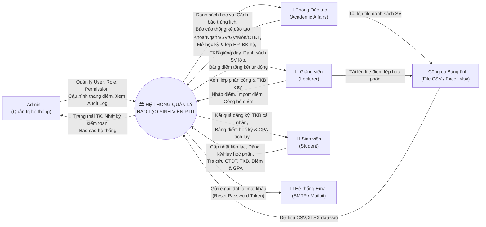

### 1.3. Mã nguồn PlantUML
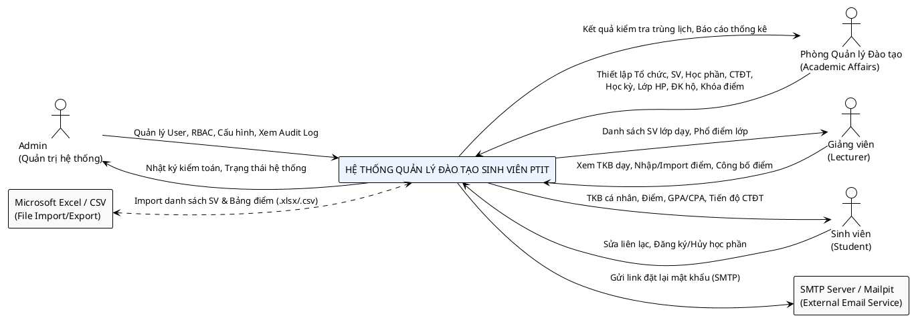

### 1.4. Giải thích ký hiệu & Kiểm tra tính nhất quán
- **Ký hiệu:** Nút trung tâm là hệ thống mục tiêu; 4 Actor bên trái là người dùng trực tiếp (khớp `D-07`); 2 khối bên phải là tác nhân/hệ thống phụ trợ (Email SMTP cho `FR-AUTH-04` và File CSV/Excel cho `FR-STU-04`, `FR-GRD-02`).
- **Tính nhất quán:** Không có hệ thống thanh toán hay cổng SSO ngoài phạm vi v1.0 (khớp Scope Document ở Giai đoạn 1).

---

## 2. USE CASE DIAGRAMS (MỤC 6.2 & 9.3.6)

### 2.1. Quy ước quan hệ UML Use Case sử dụng trong dự án
1. **Association (`-->`):** Kết nối giữa Actor và Use Case mà Actor đó trực tiếp khởi phát.
2. **Include (`..> <<include>>`):** Use Case cơ sở **luôn luôn bắt buộc** thực thi Use Case được include (ví dụ: `Đăng ký học phần` luôn `<<include>>` `Kiểm tra điều kiện đăng ký`; `Mở lớp học phần` luôn `<<include>>` `Kiểm tra trùng lịch Phòng & Giảng viên`).
3. **Extend (`<.. <<extend>>`):** Use Case mở rộng **chỉ thực thi có điều kiện** từ Use Case cơ sở (mũi tên trỏ từ Use Case mở rộng về Use Case gốc; ví dụ: `Import bảng điểm từ Excel` `<<extend>>` `Nhập điểm thành phần`).

---

### 2.2. Sơ đồ Use Case Tổng quan (Overall Use Case Diagram)

#### Mục đích & Phạm vi
Thể hiện bức tranh tổng thể các nhóm chức năng chính của toàn hệ thống và sự phân bổ cho 4 Actor trong ranh giới hệ thống (`System Boundary`).

#### Sơ đồ trực quan (Mermaid)
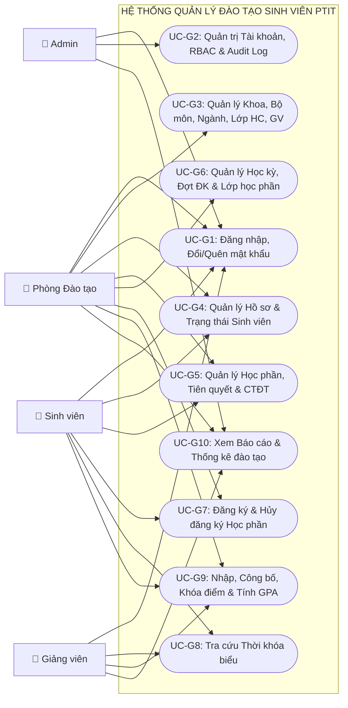

#### Mã nguồn PlantUML (Overall Use Case)
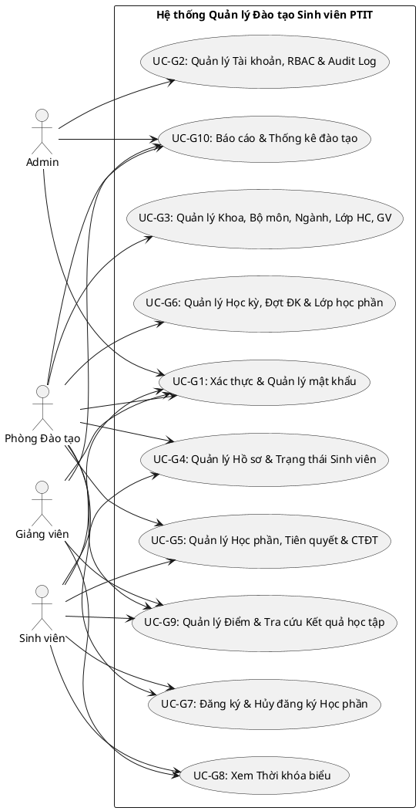

---

### 2.3. Use Case Chi tiết Phân hệ 1: Authentication & Authorization (Bắt buộc theo Mục 9.3.6)

#### Mục đích & Phạm vi
Mô tả chi tiết các ca sử dụng thuộc phân hệ Xác thực (Authentication) và Phân quyền RBAC / Kiểm toán (Authorization), bao gồm cả cơ chế thu hồi Refresh Token khi khóa tài khoản.

#### Sơ đồ trực quan (Mermaid)
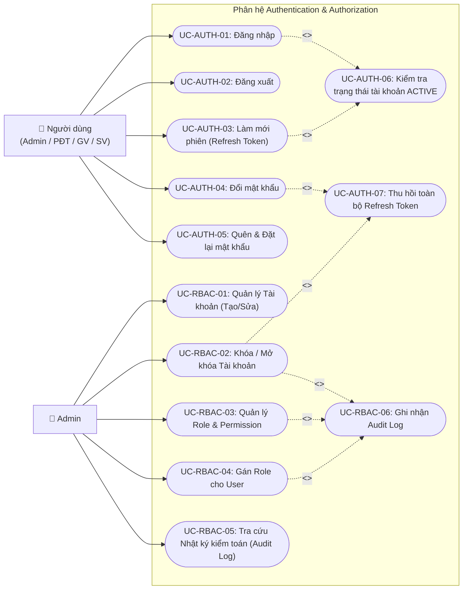

#### Mã nguồn PlantUML (Authentication & Authorization Use Case)
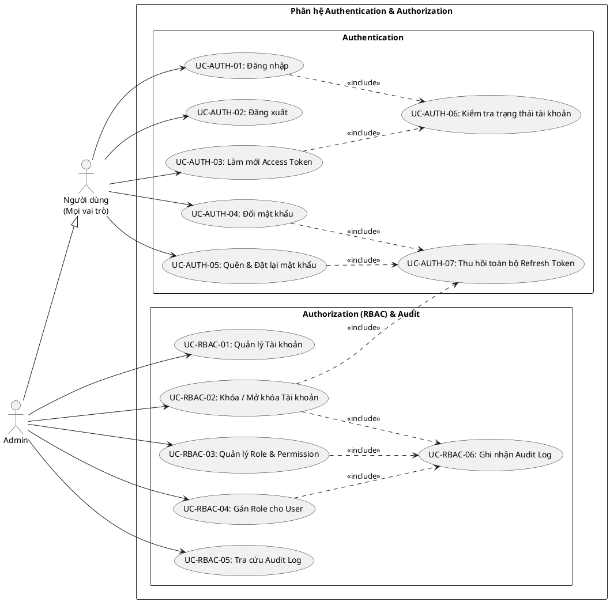

#### Giải thích ký hiệu & Quan hệ
- **Generalization (`Admin --|> User`):** Admin kế thừa toàn bộ các Use Case xác thực của một Người dùng thông thường và có thêm các Use Case quản trị RBAC.
- **`<<include>>` `UC-AUTH-06`:** Cả lúc Đăng nhập và lúc Làm mới token đều bắt buộc kiểm tra tài khoản còn `ACTIVE` (`BR-02`).
- **`<<include>>` `UC-AUTH-07`:** Khi Đổi mật khẩu, Đặt lại mật khẩu hoặc khi Admin Khóa tài khoản, hệ thống luôn bắt buộc thu hồi mọi Refresh Token đang hoạt động của user đó.

---

### 2.4. Use Case Chi tiết Phân hệ 2: Tổ chức, Sinh viên, Học phần & Chương trình đào tạo

#### Mục đích & Phạm vi
Thể hiện các Use Case thiết lập dữ liệu gốc học vụ của Phòng đào tạo và các Use Case tra cứu/cập nhật hồ sơ của Sinh viên.

#### Sơ đồ trực quan (Mermaid)
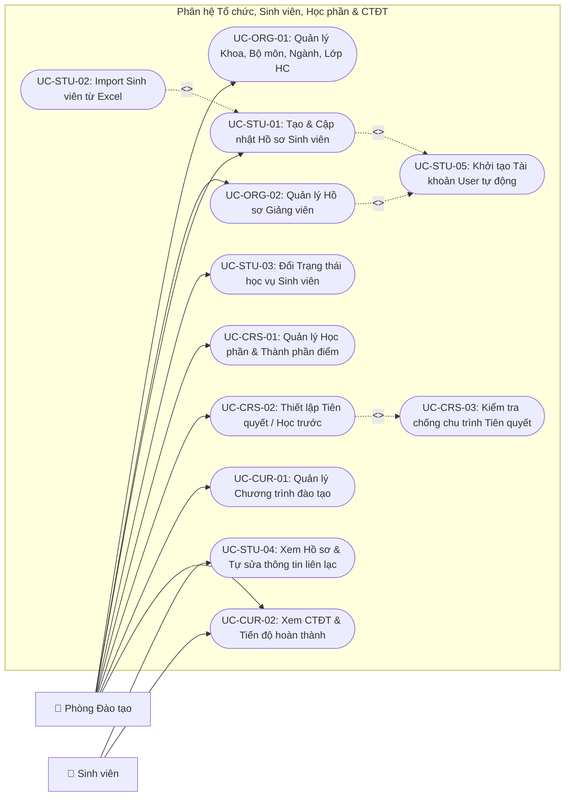

#### Mã nguồn PlantUML
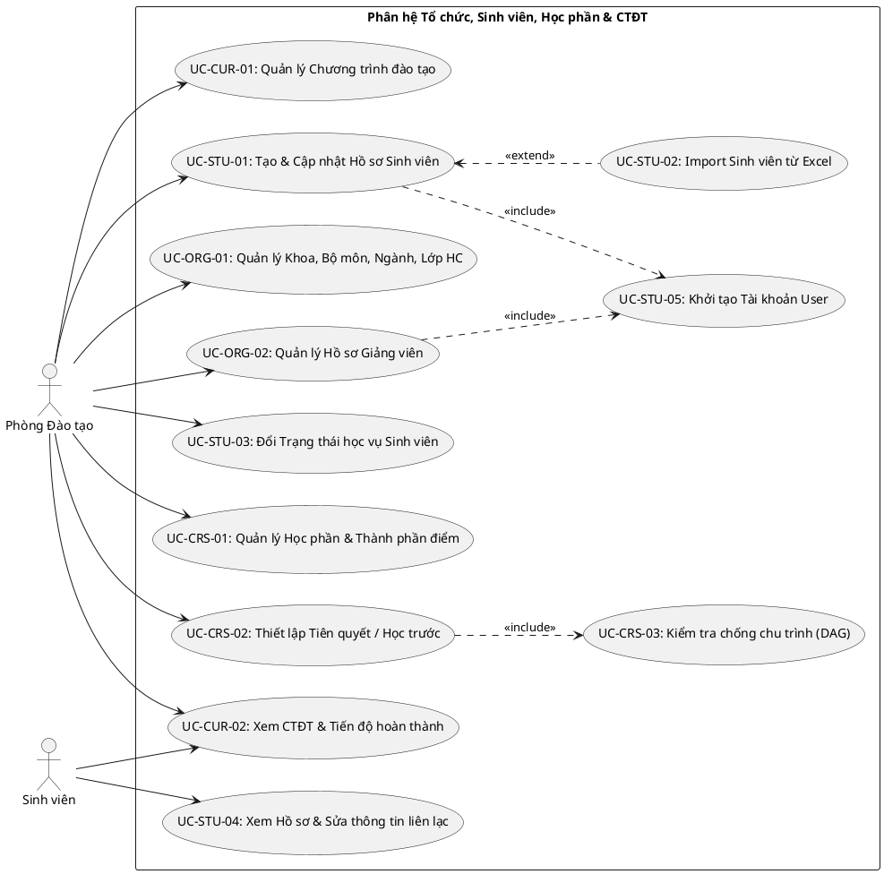

---

### 2.5. Use Case Chi tiết Phân hệ 3: Học kỳ, Lớp học phần, Thời khóa biểu & Đăng ký học phần

#### Mục đích & Phạm vi
Thể hiện các Use Case trọng tâm về lập kế hoạch học kỳ, mở lớp học phần có kiểm tra trùng lịch và đăng ký học phần.

#### Sơ đồ trực quan (Mermaid)
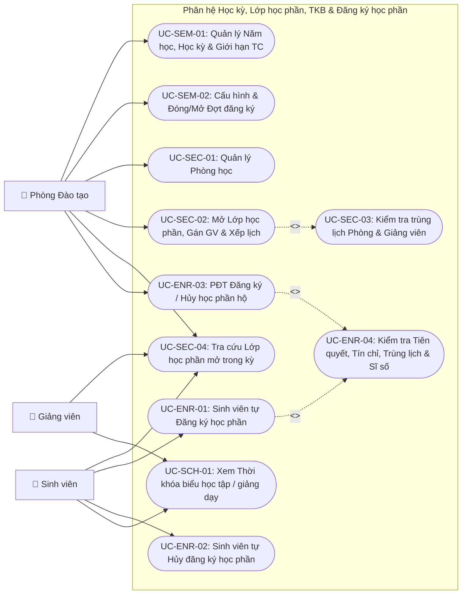

#### Mã nguồn PlantUML
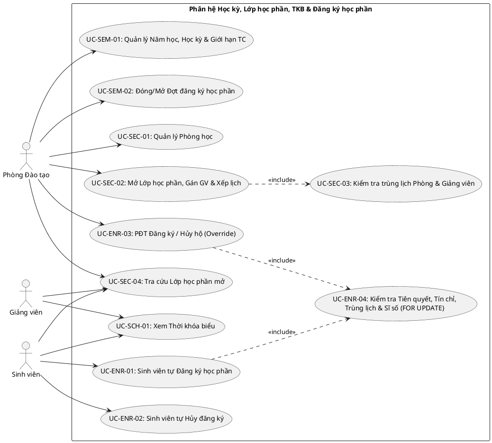

---

### 2.6. Use Case Chi tiết Phân hệ 4: Quản lý Điểm, Kết quả học tập & Báo cáo

#### Mục đích & Phạm vi
Mô tả các Use Case nhập điểm, import điểm, tính tự động điểm tổng kết, công bố, khóa sổ, điều chỉnh đặc biệt và tra cứu kết quả / báo cáo.

#### Sơ đồ trực quan (Mermaid)
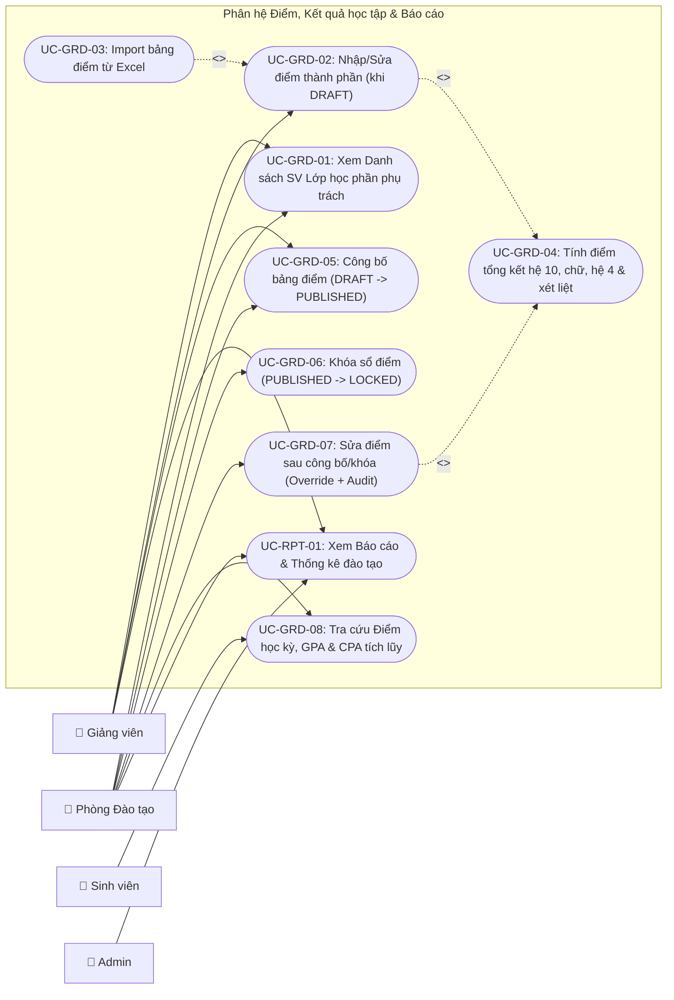

#### Mã nguồn PlantUML
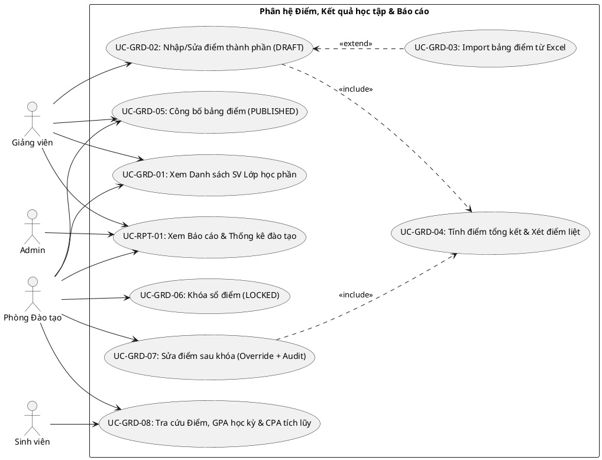

---

## 3. USE CASE SPECIFICATIONS (ĐẶC TẢ CHI TIẾT CÁC USE CASE TRỌNG TÂM — MỤC 6.3)

### 3.1. `UC-AUTH-01` — Đăng nhập hệ thống
| Hạng mục | Nội dung |
|---|---|
| **Use Case ID** | `UC-AUTH-01` |
| **Use Case Name** | Đăng nhập hệ thống (User Login) |
| **Actor** | Admin, Phòng đào tạo, Giảng viên, Sinh viên |
| **Description** | Người dùng xác thực danh tính bằng tài khoản và mật khẩu để truy cập vào không gian làm việc tương ứng với vai trò của mình. |
| **Preconditions** | Người dùng đã có tài khoản trong bảng `users`. |
| **Trigger** | Người dùng nhập tài khoản, mật khẩu và bấm nút **"Đăng nhập"** trên màn hình `/login`. |
| **Main Flow** | 1. Người dùng nhập `usernameOrEmail` và `password`, nhấn "Đăng nhập". 2. Frontend kiểm tra không để trống và gửi `POST /api/v1/auth/login`. 3. Backend tra cứu bản ghi `User` theo `username` hoặc `email`. 4. Backend đối chiếu mật khẩu bằng `BCryptPasswordEncoder.matches()`. 5. Backend kiểm tra `user.status == 'ACTIVE'`. 6. Backend truy vấn danh sách `Role` và `Permission` của người dùng. 7. Backend sinh JWT `accessToken` (15 phút) và `refreshToken` (7 ngày, lưu hash SHA-256 vào bảng `refresh_tokens`), cập nhật `last_login_at`. 8. Backend trả về `HTTP 200 OK` kèm header `Set-Cookie` (`HttpOnly`) và thông tin người dùng. 9. Frontend điều hướng người dùng tới Dashboard tương ứng với vai trò (`/admin`, `/academic`, `/lecturer`, hoặc `/student`). |
| **Alternative Flow** | **AF-01 (Đã đăng nhập sẵn):** Nếu người dùng truy cập `/login` khi đã có `accessToken` hợp lệ, hệ thống tự động điều hướng thẳng vào Dashboard. |
| **Exception Flow** | **EF-01 (Không tồn tại tài khoản hoặc sai mật khẩu – tại bước 3, 4):** Hệ thống trả về `HTTP 401` với thông báo `"Tài khoản hoặc mật khẩu không chính xác"`. **EF-02 (Tài khoản bị khóa – tại bước 5):** Nếu `user.status == 'LOCKED'` hoặc `'INACTIVE'`, hệ thống trả về `HTTP 403` với thông báo `"Tài khoản của bạn đã bị khóa. Vui lòng liên hệ Quản trị viên"`. |
| **Postconditions** | **Thành công:** Một bản ghi `refresh_tokens` mới được lưu trong DB; trình duyệt giữ cookie `HttpOnly`. **Thất bại:** Không có phiên nào được tạo. |
| **Business Rules** | `BR-01`, `BR-02`, `BR-03` |
| **Related Requirements** | `FR-AUTH-01`, `NFR-SEC-01` |

---

### 3.2. `UC-STU-01` — Quản lý Hồ sơ Sinh viên (Tạo mới & Import)
| Hạng mục | Nội dung |
|---|---|
| **Use Case ID** | `UC-STU-01` |
| **Use Case Name** | Tạo mới và Cập nhật Hồ sơ Sinh viên |
| **Actor** | Phòng Quản lý Đào tạo (`ACADEMIC_AFFAIRS`) |
| **Description** | Cán bộ Phòng đào tạo thêm mới hồ sơ sinh viên (từng cá nhân hoặc qua file Excel) và hệ thống tự động khởi tạo tài khoản đăng nhập cho sinh viên đó. |
| **Preconditions** | Cán bộ Phòng đào tạo đã đăng nhập và có quyền `STUDENT_WRITE`; danh mục Khoa, Ngành, Lớp hành chính đã tồn tại. |
| **Trigger** | Cán bộ chọn **"Thêm sinh viên"** hoặc **"Import Excel"** tại màn hình Quản lý sinh viên. |
| **Main Flow** | 1. Cán bộ nhập thông tin sinh viên (`studentCode`, `fullName`, `dateOfBirth`, `gender`, `nationalId`, `email`, `academicClassId`, `majorId`, `cohortYear`) và bấm "Lưu". 2. Hệ thống kiểm tra định dạng dữ liệu và kiểm tra không trùng `studentCode`, `email`, `nationalId`. 3. Hệ thống kiểm tra `academicClassId` thuộc đúng `majorId`. 4. Hệ thống mở Database Transaction:    - Tạo bản ghi `users` với `username = studentCode`, `email`, mật khẩu mặc định băm `BCrypt`, `status = 'ACTIVE'`.    - Gán Role `STUDENT` vào `user_roles`.    - Tạo bản ghi `students` liên kết `user_id`, `academic_status = 'ACTIVE'`.    - Ghi bản ghi khởi tạo vào `student_status_history`. 5. Hệ thống commit Transaction và trả về thông tin hồ sơ sinh viên vừa tạo (`HTTP 201`). |
| **Alternative Flow** | **AF-01 (Import từ file Excel – `UC-STU-02`):** 1a. Cán bộ tải file `.xlsx` lên. 2a. Hệ thống đọc toàn bộ dòng, kiểm tra hợp lệ từng dòng và trả về màn hình Preview. 3a. Nếu 0 lỗi và cán bộ bấm "Xác nhận Import", hệ thống thực hiện bước 4 cho toàn bộ danh sách trong 1 Transaction duy nhất. |
| **Exception Flow** | **EF-01 (Trùng Mã SV / Email / CCCD):** Rollback Transaction, trả về `HTTP 409 CONFLICT` chỉ rõ trường bị trùng. **EF-02 (File Import có dòng lỗi):** Không ghi dòng nào vào DB, trả về danh sách dòng lỗi kèm nguyên nhân (`BR-32`). |
| **Postconditions** | Hồ sơ `Student` và tài khoản `User` tương ứng được lưu nhất quán trong DB. |
| **Business Rules** | `BR-04`, `BR-05`, `BR-06`, `BR-08`, `BR-32` |
| **Related Requirements** | `FR-STU-01`, `FR-STU-02`, `FR-STU-04` |

---

### 3.3. `UC-SEC-02` — Mở Lớp học phần, Phân công Giảng viên & Xếp lịch học
| Hạng mục | Nội dung |
|---|---|
| **Use Case ID** | `UC-SEC-02` |
| **Use Case Name** | Mở Lớp học phần, Phân công Giảng viên và Xếp lịch học |
| **Actor** | Phòng Quản lý Đào tạo (`ACADEMIC_AFFAIRS`) |
| **Description** | Mở lớp học phần trong một học kỳ, gán giảng viên dạy và xếp lịch học theo phòng – thứ – tiết – tuần có kiểm tra chống xung đột. |
| **Preconditions** | Học kỳ, Học phần, Giảng viên và Phòng học đã được tạo và ở trạng thái `ACTIVE`. |
| **Trigger** | Cán bộ Phòng đào tạo chọn **"Mở lớp học phần"** trong màn hình Quản lý lớp học phần. |
| **Main Flow** | 1. Cán bộ chọn Học kỳ, Học phần, nhập Số nhóm (`groupNumber`), Sĩ số tối đa (`maxCapacity`), chọn Giảng viên phụ trách và thêm một hoặc nhiều dòng lịch học `(dayOfWeek, startPeriod, endPeriod, startWeek, endWeek, classroomId)`. 2. Hệ thống kiểm tra cặp `(courseId, semesterId, groupNumber)` chưa tồn tại. 3. Hệ thống kiểm tra `maxCapacity <= classroom.capacity` với mọi phòng học được chọn. 4. Hệ thống kiểm tra **trùng lịch Phòng học (`BR-16`)**: không có lớp học phần nào khác đang mở trong cùng học kỳ sử dụng cùng `classroomId` có cùng `dayOfWeek`, giao đoạn tuần và giao đoạn tiết. 5. Hệ thống kiểm tra **trùng lịch Giảng viên (`BR-17`)**: giảng viên được chọn không dạy lớp nào khác trong cùng học kỳ bị trùng `dayOfWeek`, giao đoạn tuần và giao đoạn tiết. 6. Hệ thống lưu `course_sections` (`status = 'OPEN'`, `grade_status = 'DRAFT'`, `current_enrolled = 0`) và các dòng `section_schedules` trong 1 Transaction. 7. Hệ thống trả về thông tin lớp học phần vừa mở (`HTTP 201`). |
| **Alternative Flow** | **AF-01 (Chưa phân công Giảng viên ngay lúc mở lớp):** Cán bộ có thể để trống `lecturerId` khi tạo lớp và phân công bổ sung trước khi học kỳ bắt đầu. |
| **Exception Flow** | **EF-01 (Vượt sức chứa phòng học):** Trả `HTTP 400 CLASSROOM_CAPACITY_EXCEEDED`. **EF-02 (Trùng lịch Phòng học):** Trả `HTTP 409 SCHEDULE_CLASSROOM_CONFLICT` kèm mã lớp học phần đang chiếm phòng. **EF-03 (Trùng lịch Giảng viên):** Trả `HTTP 409 SCHEDULE_LECTURER_CONFLICT` kèm mã lớp học phần giảng viên đang dạy. |
| **Postconditions** | Lớp học phần và lịch học được tạo, đảm bảo không có xung đột lịch phòng và lịch giảng viên. |
| **Business Rules** | `BR-14`, `BR-15`, `BR-16`, `BR-17`, `BR-18` |
| **Related Requirements** | `FR-SEC-01`, `FR-SEC-02` |

---

### 3.4. `UC-ENR-01` — Sinh viên tự Đăng ký học phần (Trọng tâm Transaction & Concurrency)
| Hạng mục | Nội dung |
|---|---|
| **Use Case ID** | `UC-ENR-01` |
| **Use Case Name** | Sinh viên tự Đăng ký Lớp học phần |
| **Actor** | Sinh viên (`STUDENT`) |
| **Description** | Sinh viên chọn đăng ký một lớp học phần đang mở trong đợt đăng ký của học kỳ hiện hành. Hệ thống kiểm tra toàn bộ điều kiện học vụ và xử lý đồng thời an toàn. |
| **Preconditions** | Sinh viên đã đăng nhập, có Role `STUDENT`. |
| **Trigger** | Sinh viên bấm nút **"Đăng ký"** tại một lớp học phần trên màn hình Đăng ký học phần. |
| **Main Flow** | 1. Frontend gửi `POST /api/v1/enrollments` với `{ sectionId }`. 2. Backend mở `@Transactional` và lấy hồ sơ `Student` của người dùng đang đăng nhập. 3. Kiểm tra `student.academic_status == 'ACTIVE'` (`BR-19`). 4. Thực thi `SELECT ... FROM course_sections WHERE id = :sectionId FOR UPDATE` để khóa dòng lớp học phần (`BR-25`). 5. Kiểm tra `section.status == 'OPEN'` và đợt đăng ký của học kỳ đang mở (`semester.is_registration_open == true` và `NOW()` thuộc `[registration_start_at, registration_end_at]`, `BR-20`). 6. Kiểm tra sĩ số: `section.current_enrolled < section.max_capacity` (`BR-25`). 7. Kiểm tra sinh viên chưa có bản ghi `ENROLLED` nào của cùng `course_id` trong cùng `semester_id` (`BR-21`). 8. Kiểm tra điều kiện Tiên quyết (`PREREQUISITE`: đã qua môn ở kỳ trước với `is_passed = true`) và Học trước (`COREQUISITE`: đã có điểm tổng kết ở kỳ trước) của `section.course_id` (`BR-22`). 9. Kiểm tra tổng số tín chỉ đã đăng ký trong kỳ + `course.credits <= semester.max_credits` (`BR-23`). 10. Kiểm tra lịch học của `sectionId` không trùng với bất kỳ lớp nào sinh viên đang `ENROLLED` trong kỳ (`BR-24`). 11. Lưu bản ghi `enrollments` (`status = 'ENROLLED'`), cập nhật `course_sections.current_enrolled = current_enrolled + 1`, ghi log và **Commit Transaction**. 12. Trả kết quả đăng ký thành công (`HTTP 201`) để Frontend cập nhật danh sách đã đăng ký và sĩ số lớp. |
| **Alternative Flow** | **AF-01 (Đăng ký học lại / học cải thiện):** Nếu sinh viên đã từng học môn này ở học kỳ trước (đã trượt `F` hoặc đã qua nhưng muốn cải thiện điểm), hệ thống tính `attempt_number = số_lần_trước + 1` và cho phép đăng ký bình thường (`BR-27`). **AF-02 (Đăng ký lại lớp vừa hủy trong cùng kỳ):** Nếu sinh viên đã đăng ký rồi hủy chính lớp đó trước đó (`status = 'CANCELLED'`), hệ thống chuyển bản ghi về `ENROLLED` (sau khi vượt qua đầy đủ bước 3 → 10) và tăng `current_enrolled` thêm 1. |
| **Exception Flow** | **EF-01 (`403 ENROLL_STUDENT_NOT_ACTIVE`):** Sinh viên đang bảo lưu, đình chỉ, thôi học hoặc đã tốt nghiệp. **EF-02 (`400 ENROLL_PERIOD_CLOSED`):** Ngoài thời gian đợt đăng ký hoặc đợt đăng ký đã đóng. **EF-03 (`409 ENROLL_SECTION_FULL`):** Lớp đã đủ sĩ số (bao gồm trường hợp thua cuộc khi tranh suất cuối cùng). **EF-04 (`409 ENROLL_DUPLICATE_COURSE_IN_SEMESTER`):** Đã đăng ký một nhóm lớp khác của cùng môn học trong kỳ. **EF-05 (`400 ENROLL_PREREQUISITE_NOT_MET`):** Chưa đạt môn tiên quyết hoặc chưa học môn học trước. **EF-06 (`400 ENROLL_MAX_CREDITS_EXCEEDED`):** Vượt quá số tín chỉ tối đa của học kỳ. **EF-07 (`409 ENROLL_SCHEDULE_CONFLICT`):** Trùng thứ/tiết/tuần với một lớp đã đăng ký. *Mọi Exception Flow đều tự động Rollback Transaction.* |
| **Postconditions** | Bản ghi `Enrollment` ở trạng thái `ENROLLED`; `current_enrolled` tăng đúng 1; không bao giờ vượt `max_capacity`. |
| **Business Rules** | `BR-15`, `BR-19` → `BR-27` |
| **Related Requirements** | `FR-ENR-01`, `NFR-INT-01`, `NFR-PERF-02` |

---

### 3.5. `UC-ENR-02` — Sinh viên tự Hủy đăng ký học phần
| Hạng mục | Nội dung |
|---|---|
| **Use Case ID** | `UC-ENR-02` |
| **Use Case Name** | Sinh viên tự Hủy đăng ký Lớp học phần |
| **Actor** | Sinh viên (`STUDENT`) |
| **Description** | Sinh viên rút khỏi một lớp học phần đã đăng ký khi đợt đăng ký vẫn đang mở. |
| **Preconditions** | Sinh viên đang có bản ghi `Enrollment` ở trạng thái `ENROLLED`. |
| **Trigger** | Sinh viên bấm **"Hủy đăng ký"** tại môn học trong danh sách học phần đã đăng ký. |
| **Main Flow** | 1. Sinh viên xác nhận hủy trên hộp thoại cảnh báo. 2. Backend mở `@Transactional`, kiểm tra bản ghi `Enrollment` thuộc về chính sinh viên đang đăng nhập và có `status == 'ENROLLED'`. 3. Kiểm tra đợt đăng ký của học kỳ đang mở (`BR-20`). 4. Khóa dòng `CourseSection` (`FOR UPDATE`). 5. Cập nhật `enrollment.status = 'CANCELLED'`, `cancelled_at = NOW()`, `cancelled_by = currentUserId`. 6. Giảm `course_sections.current_enrolled = current_enrolled - 1`. 7. Commit Transaction và trả về `HTTP 200 OK`. |
| **Alternative Flow** | Không có. |
| **Exception Flow** | **EF-01 (`400 ENROLL_PERIOD_CLOSED`):** Đợt đăng ký đã kết thúc; thông báo sinh viên liên hệ Phòng đào tạo nếu muốn rút học phần đặc biệt. **EF-02 (`403 FORBIDDEN`):** Cố tình truyền `enrollmentId` của sinh viên khác. |
| **Postconditions** | Bản ghi `Enrollment` chuyển sang `CANCELLED` (không xóa vật lý); lớp học phần có thêm 1 suất trống. |
| **Business Rules** | `BR-03`, `BR-20`, `BR-26` |
| **Related Requirements** | `FR-ENR-02` |

---

### 3.6. `UC-GRD-02` & `UC-GRD-05` — Nhập, Tính tự động và Công bố Điểm lớp học phần
| Hạng mục | Nội dung |
|---|---|
| **Use Case ID** | `UC-GRD-02` & `UC-GRD-05` |
| **Use Case Name** | Nhập điểm thành phần, Tính điểm tổng kết và Công bố bảng điểm |
| **Actor** | Giảng viên (`LECTURER`) |
| **Description** | Giảng viên nhập điểm các thành phần cho sinh viên trong lớp học phần mình dạy, hệ thống tự động tính điểm tổng kết và giảng viên công bố bảng điểm. |
| **Preconditions** | Giảng viên đã đăng nhập, được phân công phụ trách lớp học phần (`section.lecturer_id == currentLecturerId`) và lớp đang có `grade_status == 'DRAFT'`. |
| **Trigger** | Giảng viên bấm **"Lưu bảng điểm"** hoặc **"Công bố điểm"** tại màn hình Quản lý điểm lớp học phần. |
| **Main Flow** | 1. Giảng viên mở lớp học phần được phân công; hệ thống hiển thị danh sách sinh viên `ENROLLED` và các cột thành phần điểm của môn học (ví dụ: Chuyên cần 10%, KT/TH 20%, Giữa kỳ 20%, Cuối kỳ 50%). 2. Giảng viên nhập/sửa điểm trên lưới (hoặc upload file Excel qua `UC-GRD-03`) và bấm **"Lưu nháp"**. 3. Backend kiểm tra quyền phụ trách lớp (`BR-03`), trạng thái `grade_status == 'DRAFT'` (`BR-30`) và mọi điểm nằm trong `[0.0, 10.0]` (`BR-28`). 4. Backend lưu vào `student_grades`. Với những sinh viên đã có đủ tất cả đầu điểm thành phần, hệ thống tự động tính `final_score_10`, kiểm tra điểm liệt cuối kỳ (`< 4.0`), quy đổi `letter_grade`, `gpa_score_4` và `is_passed` (`BR-29`). 5. Khi đã nhập đủ điểm cho 100% sinh viên trong lớp, Giảng viên bấm **"Công bố điểm"**. 6. Backend kiểm tra không còn sinh viên nào thiếu đầu điểm, chuyển `section.grade_status = 'PUBLISHED'`, `published_at = NOW()`, ghi `AuditLog` và trả kết quả thành công. |
| **Alternative Flow** | **AF-01 (Lưu từng phần):** Giảng viên có thể nhập điểm Chuyên cần và Giữa kỳ trước, lưu nháp nhiều lần trước khi nhập điểm Cuối kỳ và Công bố. |
| **Exception Flow** | **EF-01 (`403 GRADE_NOT_ASSIGNED_LECTURER`):** Giảng viên không phải người được phân công dạy lớp này. **EF-02 (`400 GRADE_ALREADY_PUBLISHED_OR_LOCKED`):** Bảng điểm đã ở trạng thái `PUBLISHED` hoặc `LOCKED`. **EF-03 (`400 GRADE_INCOMPLETE_FOR_PUBLISH`):** Bấm Công bố khi vẫn còn sinh viên trong lớp chưa có đủ đầu điểm. |
| **Postconditions** | Điểm thành phần và điểm tổng kết được lưu chính xác; khi chuyển sang `PUBLISHED`, sinh viên xem được điểm và giảng viên không tự sửa được nữa. |
| **Business Rules** | `BR-03`, `BR-28`, `BR-29`, `BR-30`, `BR-32` |
| **Related Requirements** | `FR-GRD-01`, `FR-GRD-02`, `FR-GRD-03`, `FR-GRD-04` |
