# GIAI ĐOẠN 3 (PHẦN 3): CLASS, STATE, COMPONENT & DEPLOYMENT DIAGRAMS

> [!NOTE]
> Tài liệu này hoàn thiện mục **6.6 (Class Diagram)**, **6.7 (State Diagram)**, **6.8 (Component Diagram)** và **6.9 (Deployment Diagram)** của [Planning.md](file:///f:/QUẢN-LÝ-SINH-VIÊN-2/Planning.md#L382-L429), kèm **Checklist nghiệm thu Giai đoạn 3**.

---

## 1. CLASS DIAGRAM (MỤC 6.6)

Theo yêu cầu mục 6.6, phần này phân biệt rõ **2 mức độ Class Diagram**:
1. **Domain Analysis Class Diagram (Mức phân tích nghiệp vụ):** Tập trung vào các lớp thực thể miền nghiệp vụ (Domain Entities), thuộc tính, hành vi nghiệp vụ cốt lõi và mối quan hệ giữa chúng (`Association`, `Aggregation o--`, `Composition *--`, `Inheritance <|--`, `Multiplicity`).
2. **Software Design Class Diagram (Mức thiết kế phần mềm – Spring Boot):** Thể hiện cấu trúc phân tầng `Controller → Service → Repository → Entity / DTO` và `Security`.

### 1.1. Giải thích ký hiệu UML Class Diagram sử dụng
- **Visibility (Phạm vi truy cập):** `-` (`private`), `#` (`protected`), `+` (`public`).
- **Inheritance (`<|--`):** Kế thừa (ví dụ `BaseAuditableEntity <|-- CourseSection`).
- **Composition (`*--`):** Quan hệ hợp thành chặt (vòng đời con phụ thuộc hoàn toàn vào cha; ví dụ `Course *-- GradeComponent`, `CourseSection *-- SectionSchedule`, `Enrollment *-- StudentGrade`).
- **Aggregation (`o--`):** Quan hệ tập hợp lỏng (con có thể tồn tại độc lập với cha; ví dụ `Faculty o-- Department`, `Department o-- Lecturer`, `AcademicClass o-- Student`).
- **Association (`-->`):** Liên kết tham chiếu thông thường kèm bản số (`1`, `0..1`, `1..*`, `0..*`).

---

### 1.2. Domain Analysis Class Diagram (Mức phân tích nghiệp vụ)

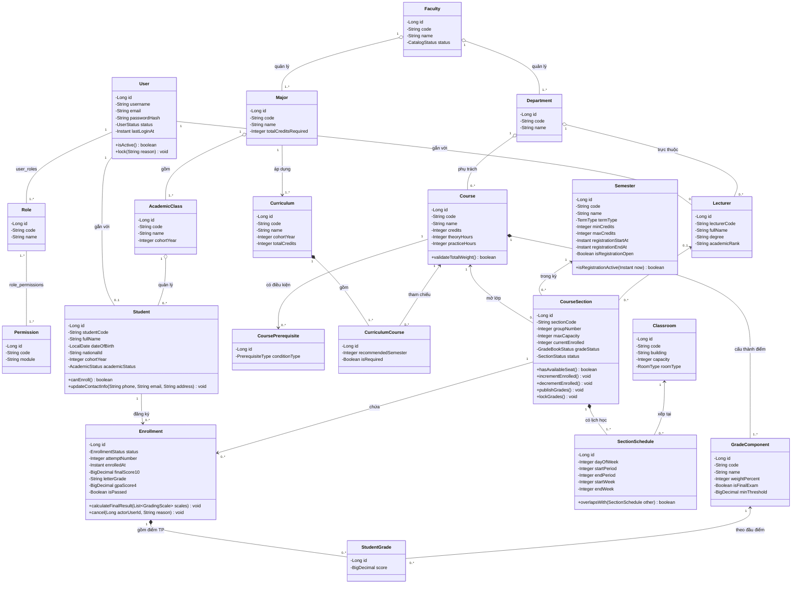

---

### 1.3. Software Design Class Diagram (Mức thiết kế phần mềm – Phân hệ Đăng ký & Điểm trong Spring Boot)

```mermaid
classDiagram
    direction TB

    class EnrollmentController {
        -EnrollmentService enrollmentService
        +enroll(UserPrincipal user, EnrollRequestDto dto) ResponseEntity~EnrollmentResponseDto~
        +cancelMyEnrollment(UserPrincipal user, Long enrollmentId) ResponseEntity~Void~
        +overrideEnrollment(UserPrincipal aaUser, OverrideEnrollRequestDto dto) ResponseEntity~EnrollmentResponseDto~
    }

    class GradeController {
        -GradeService gradeService
        +saveSectionGrades(UserPrincipal lecUser, Long sectionId, SaveGradesRequestDto dto) ResponseEntity~SectionGradeBookDto~
        +publishGrades(UserPrincipal user, Long sectionId) ResponseEntity~Void~
        +lockGrades(UserPrincipal aaUser, Long sectionId) ResponseEntity~Void~
        +overrideScore(UserPrincipal aaUser, Long enrollmentId, OverrideScoreRequestDto dto) ResponseEntity~Void~
    }

    class EnrollmentService {
        -StudentRepository studentRepo
        -CourseSectionRepository sectionRepo
        -EnrollmentRepository enrollmentRepo
        -PrerequisiteValidator prerequisiteValidator
        -ScheduleConflictValidator scheduleValidator
        -AuditLogService auditLogService
        +enrollStudent(Long userId, Long sectionId) EnrollmentResponseDto
        +cancelStudentEnrollment(Long userId, Long enrollmentId) void
        +overrideEnrollment(Long aaUserId, OverrideEnrollRequestDto dto) EnrollmentResponseDto
    }

    class GradeService {
        -CourseSectionRepository sectionRepo
        -EnrollmentRepository enrollmentRepo
        -StudentGradeRepository studentGradeRepo
        -GradingScaleRepository gradingScaleRepo
        -GradeCalculatorDomainService gradeCalculator
        -AuditLogService auditLogService
        +saveGrades(Long lecturerUserId, Long sectionId, SaveGradesRequestDto dto) SectionGradeBookDto
        +publishSectionGrades(Long actorUserId, Long sectionId) void
        +lockSectionGrades(Long aaUserId, Long sectionId) void
    }

    class ScheduleConflictValidator {
        +hasClassroomConflict(Long semesterId, Long classroomId, SectionSchedule candidate) boolean
        +hasLecturerConflict(Long semesterId, Long lecturerId, SectionSchedule candidate) boolean
        +hasStudentConflict(Long studentId, Long semesterId, List~SectionSchedule~ candidateSchedules) boolean
    }

    class GradeCalculatorDomainService {
        +computeFinalGrade(Enrollment enrollment, List~GradeComponent~ components, List~GradingScale~ scales) GradeCalculationResult
        +computeStudentCpa(List~Enrollment~ publishedEnrollments, RetakePolicy policy) CpaSummary
    }

    class CourseSectionRepository {
        <<interface>>
        +findByIdForUpdate(Long id) Optional~CourseSection~
        +findBySemesterAndFilters(Long semesterId, Pageable pageable) Page~CourseSection~
    }

    class EnrollmentRepository {
        <<interface>>
        +existsActiveByStudentAndCourseAndSemester(Long studentId, Long courseId, Long semesterId) boolean
        +sumActiveCreditsByStudentAndSemester(Long studentId, Long semesterId) Integer
        +findAllByStudentIdWithDetails(Long studentId) List~Enrollment~
    }

    EnrollmentController --> EnrollmentService : gọi
    GradeController --> GradeService : gọi
    EnrollmentService --> CourseSectionRepository : khóa dòng FOR UPDATE
    EnrollmentService --> EnrollmentRepository : đọc/ghi
    EnrollmentService --> ScheduleConflictValidator : kiểm tra trùng lịch
    GradeService --> CourseSectionRepository : đọc/ghi
    GradeService --> EnrollmentRepository : cập nhật kết quả
    GradeService --> GradeCalculatorDomainService : tính điểm & GPA
```

#### Mã nguồn PlantUML (Class Diagram)
```plantuml
@startuml Software_Design_Class_Diagram
skinparam classAttributeIconSize 0

package "controller" {
  class EnrollmentController {
    - enrollmentService: EnrollmentService
    + enroll(user: UserPrincipal, dto: EnrollRequestDto): ResponseEntity<EnrollmentResponseDto>
    + cancelMyEnrollment(user: UserPrincipal, enrollmentId: Long): ResponseEntity<Void>
    + overrideEnrollment(aaUser: UserPrincipal, dto: OverrideEnrollRequestDto): ResponseEntity<EnrollmentResponseDto>
  }

  class GradeController {
    - gradeService: GradeService
    + saveSectionGrades(user: UserPrincipal, sectionId: Long, dto: SaveGradesRequestDto): ResponseEntity<SectionGradeBookDto>
    + publishGrades(user: UserPrincipal, sectionId: Long): ResponseEntity<Void>
    + lockGrades(aaUser: UserPrincipal, sectionId: Long): ResponseEntity<Void>
  }
}

package "service" {
  class EnrollmentService {
    - sectionRepo: CourseSectionRepository
    - enrollmentRepo: EnrollmentRepository
    - scheduleValidator: ScheduleConflictValidator
    - auditLogService: AuditLogService
    + enrollStudent(userId: Long, sectionId: Long): EnrollmentResponseDto
    + cancelStudentEnrollment(userId: Long, enrollmentId: Long): void
  }

  class GradeService {
    - sectionRepo: CourseSectionRepository
    - enrollmentRepo: EnrollmentRepository
    - gradeCalculator: GradeCalculatorDomainService
    + saveGrades(userId: Long, sectionId: Long, dto: SaveGradesRequestDto): SectionGradeBookDto
    + publishSectionGrades(userId: Long, sectionId: Long): void
    + lockSectionGrades(userId: Long, sectionId: Long): void
  }

  class ScheduleConflictValidator {
    + hasClassroomConflict(semesterId: Long, classroomId: Long, candidate: SectionSchedule): boolean
    + hasLecturerConflict(semesterId: Long, lecturerId: Long, candidate: SectionSchedule): boolean
    + hasStudentConflict(studentId: Long, semesterId: Long, schedules: List<SectionSchedule>): boolean
  }

  class GradeCalculatorDomainService {
    + computeFinalGrade(enrollment: Enrollment, components: List<GradeComponent>, scales: List<GradingScale>): GradeCalculationResult
    + computeStudentCpa(enrollments: List<Enrollment>, policy: RetakePolicy): CpaSummary
  }
}

package "repository" {
  interface CourseSectionRepository {
    + findByIdForUpdate(id: Long): Optional<CourseSection>
  }
  interface EnrollmentRepository {
    + existsActiveByStudentAndCourseAndSemester(studentId: Long, courseId: Long, semesterId: Long): boolean
    + sumActiveCreditsByStudentAndSemester(studentId: Long, semesterId: Long): Integer
  }
}

EnrollmentController --> EnrollmentService
GradeController --> GradeService
EnrollmentService --> CourseSectionRepository
EnrollmentService --> EnrollmentRepository
EnrollmentService --> ScheduleConflictValidator
GradeService --> CourseSectionRepository
GradeService --> EnrollmentRepository
GradeService --> GradeCalculatorDomainService
@enduml
```

---

## 2. STATE DIAGRAMS (VÒNG ĐỜI TRẠNG THÁI 5 ĐỐI TƯỢNG — MỤC 6.7)

### 2.1. State Diagram 1: Trạng thái Tài khoản (`User.status`)
- **Mục đích:** Mô tả vòng đời tài khoản đăng nhập và tác động thu hồi Refresh Token khi bị khóa (`BR-02`).

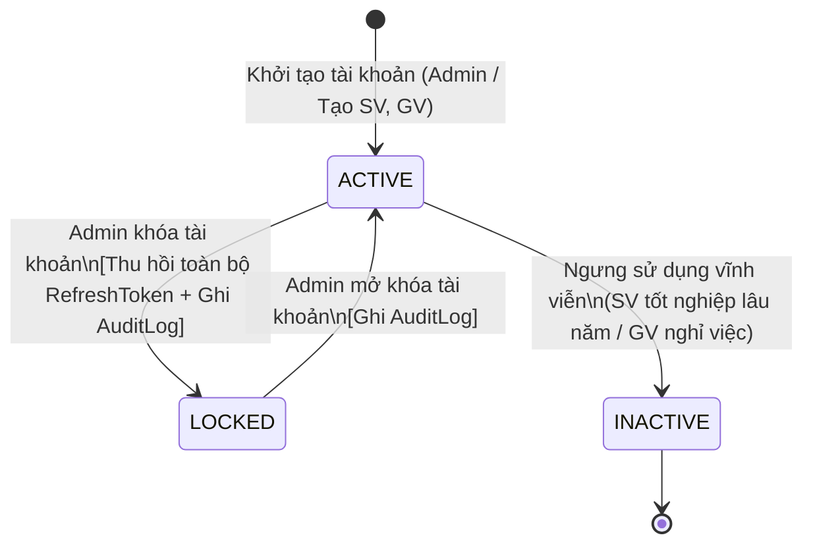

---

### 2.2. State Diagram 2: Trạng thái Học vụ của Sinh viên (`Student.academic_status`)
- **Mục đích:** Mô tả 5 trạng thái học vụ của sinh viên (`BR-08`, `BR-19`) và điều kiện chuyển trạng thái do Phòng đào tạo thực hiện.

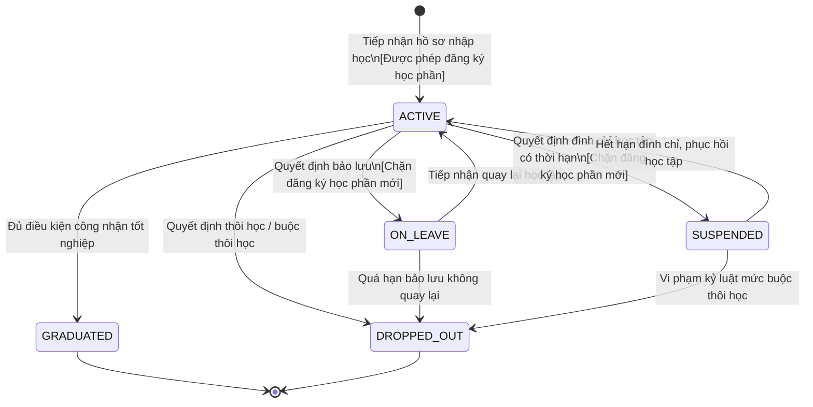

---

### 2.3. State Diagram 3: Trạng thái Vận hành Lớp học phần (`CourseSection.status`)
- **Mục đích:** Mô tả trạng thái mở/đóng/hủy của một lớp học phần trong học kỳ.

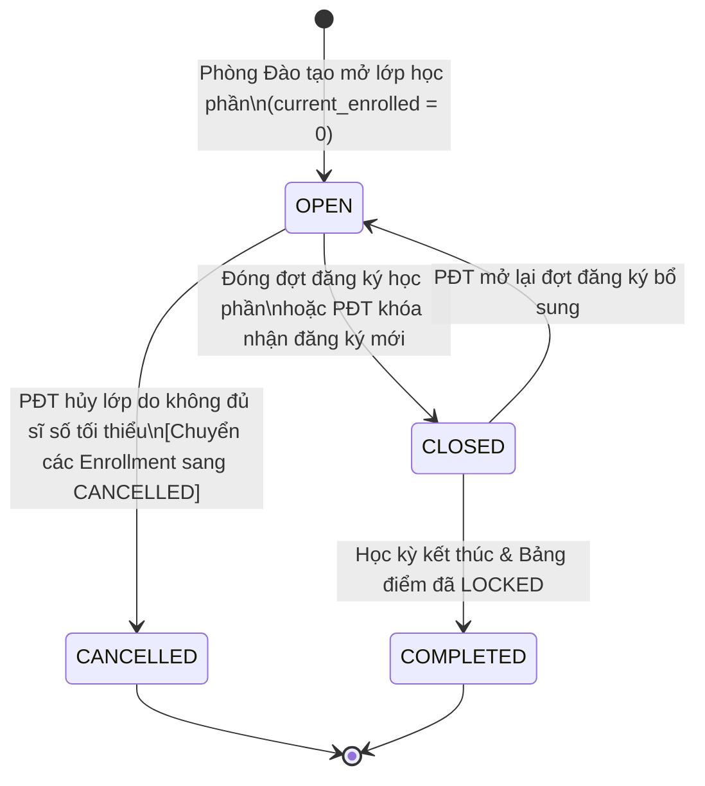

---

### 2.4. State Diagram 4: Trạng thái Lượt Đăng ký học phần (`Enrollment.status`)
- **Mục đích:** Thể hiện vòng đời của một bản ghi đăng ký học phần (`BR-21`, `BR-26`), không xóa vật lý khi hủy.

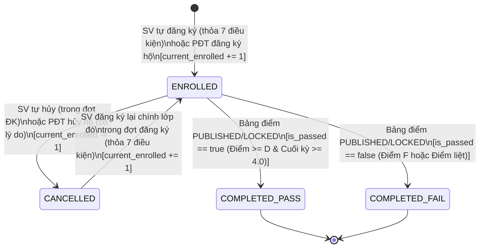

---

### 2.5. State Diagram 5: Trạng thái Bảng điểm Lớp học phần (`CourseSection.grade_status`)
- **Mục đích:** Mô tả quy trình kiểm soát điểm 3 bước `DRAFT → PUBLISHED → LOCKED` (`BR-30`).

```mermaid
stateDiagram-v2
    [*] --> DRAFT : Khi Lớp học phần được tạo\n[GV phụ trách được nhập/sửa điểm, SV chưa thấy]
    DRAFT --> DRAFT : Giảng viên lưu nháp / import điểm thành phần\n[Hệ thống tự tính điểm tổng kết tạm thời]
    DRAFT --> PUBLISHED : Giảng viên (hoặc PĐT) bấm "Công bố điểm"\n[Điều kiện: 100% SV ENROLLED đã đủ đầu điểm]\n[SV xem được điểm; GV không tự sửa được nữa]
    PUBLISHED --> LOCKED : Phòng Đào tạo bấm "Khóa sổ điểm" cuối kỳ\n[Chốt kết quả học kỳ]
    PUBLISHED --> PUBLISHED : PĐT sửa điểm đặc biệt (Override)\n[Bắt buộc nhập lý do + Ghi AuditLog]
    LOCKED --> LOCKED : PĐT sửa điểm đặc biệt sau khóa\n[Bắt buộc nhập lý do + Ghi AuditLog]
```

#### Mã nguồn PlantUML (Tổng hợp các State Diagrams)
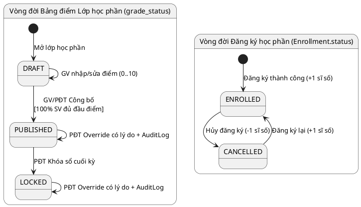

---

## 3. COMPONENT DIAGRAM (SƠ ĐỒ THÀNH PHẦN HỆ THỐNG — MỤC 6.8)

### 3.1. Mục đích & Phạm vi
Thể hiện các thành phần phần mềm của kiến trúc **Modular Monolith** (Frontend Next.js, Backend Spring Boot chia theo module nghiệp vụ, Database PostgreSQL, Flyway, SMTP/Mailpit) và giao thức kết nối giữa chúng.

### 3.2. Sơ đồ trực quan (Mermaid)
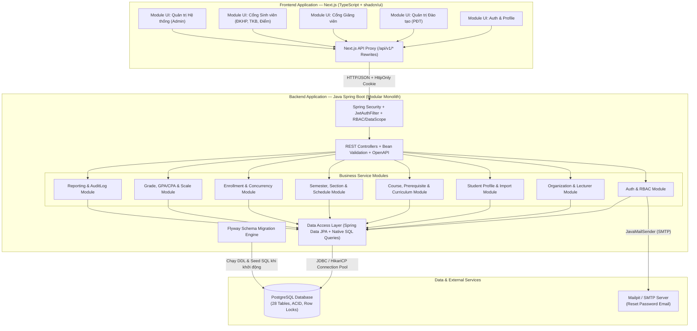

### 3.3. Mã nguồn PlantUML (Component Diagram)
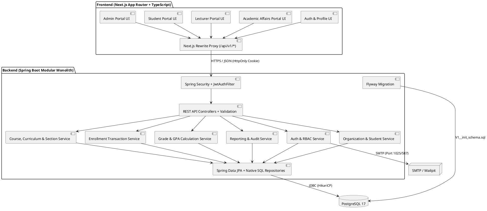

---

## 4. DEPLOYMENT DIAGRAM (SƠ ĐỒ TRIỂN KHAI — MỤC 6.9)

### 4.1. Mục đích & Phạm vi
Thiết kế mô hình triển khai gọn nhẹ, thực tế cho dự án cá nhân theo đúng quyết định `D-08` (chạy hoàn chỉnh bằng **Docker Compose** trên máy cá nhân để phát triển/demo, và sẵn sàng đưa lên 1 VPS hoặc Cloud bất kỳ khi cần mà không dùng hạ tầng phức tạp như Kubernetes).

### 4.2. Sơ đồ trực quan (Mermaid)
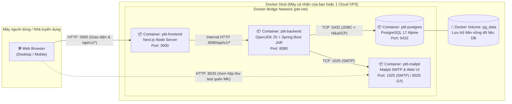

### 4.3. Mã nguồn PlantUML (Deployment Diagram)
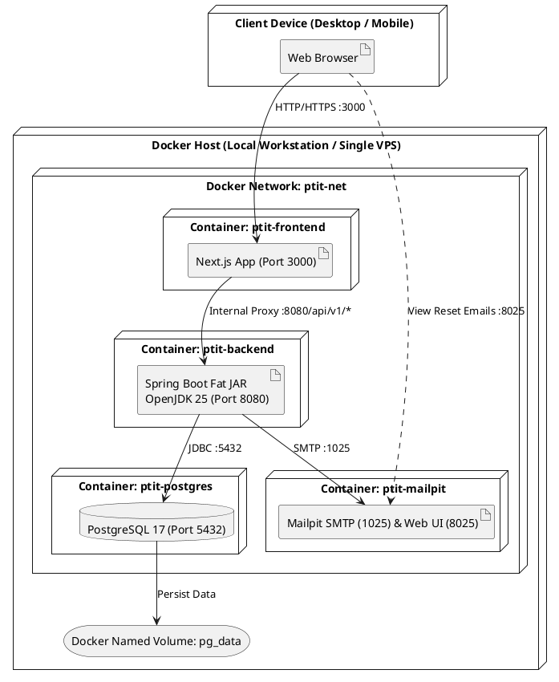

---

## 5. CHECKLIST NGHIỆM THU GIAI ĐOẠN 3 (GATE G2-A)

- [x] **System Context Diagram (6.1):** Đã xác định rõ ranh giới hệ thống, 4 Actor và 2 tác nhân phụ trợ (SMTP, CSV/Excel).
- [x] **Use Case Diagrams (6.2 & 9.3.6):** Đã xây dựng Use Case tổng quan và 4 Use Case chi tiết (bao gồm Authentication & Authorization Use Case Diagram), dùng đúng quan hệ `<<include>>`, `<<extend>>` và Generalization.
- [x] **Use Case Specifications (6.3):** Đã đặc tả chi tiết các Use Case trọng tâm kèm Preconditions, Main/Alt/Exception Flows, Postconditions và truy vết `BR`/`FR`.
- [x] **Activity Diagrams (6.4):** Đã vẽ đủ 7 Activity Diagrams có Swimlane, nhánh kiểm tra điều kiện và xử lý lỗi.
- [x] **Sequence Diagrams (6.5 & 9.3.6):** Đã vẽ đủ 5 Sequence Diagrams (bao gồm Đăng nhập, Kiểm tra quyền RBAC + Data-Scope, Đăng ký học phần có `FOR UPDATE`, Nhập & Công bố điểm, Tra cứu kết quả học tập).
- [x] **Class Diagrams (6.6):** Đã xây dựng cả Class Diagram mức Phân tích nghiệp vụ và mức Thiết kế phần mềm Spring Boot.
- [x] **State Diagrams (6.7):** Đã vẽ đủ 5 State Diagrams (`User`, `Student`, `CourseSection`, `Enrollment`, `SectionGradeBook`).
- [x] **Component & Deployment Diagrams (6.8, 6.9):** Đã thiết kế kiến trúc Modular Monolith và mô hình triển khai Docker Compose thực tế.
