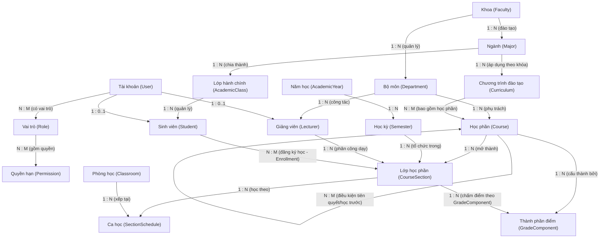
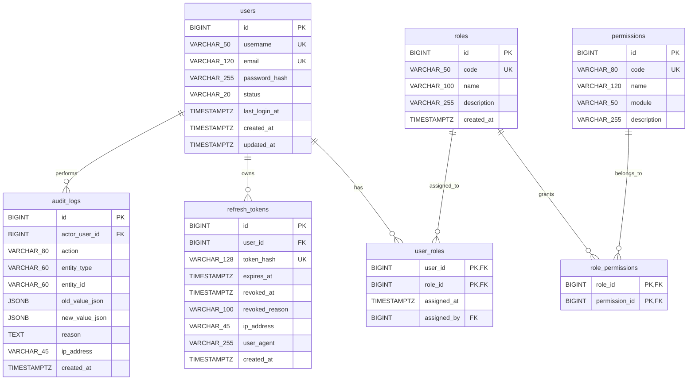
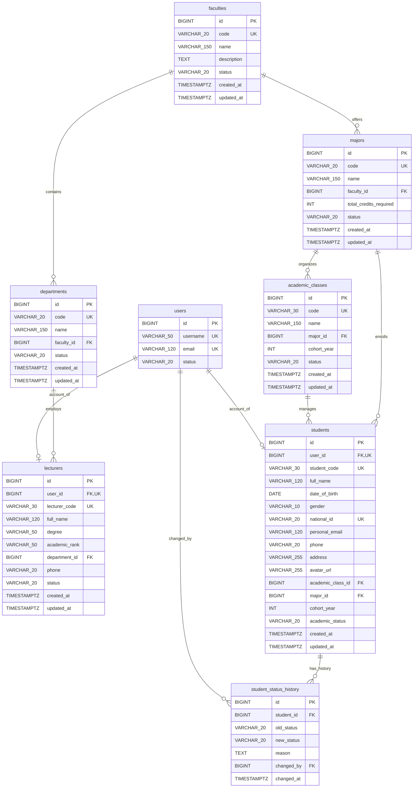
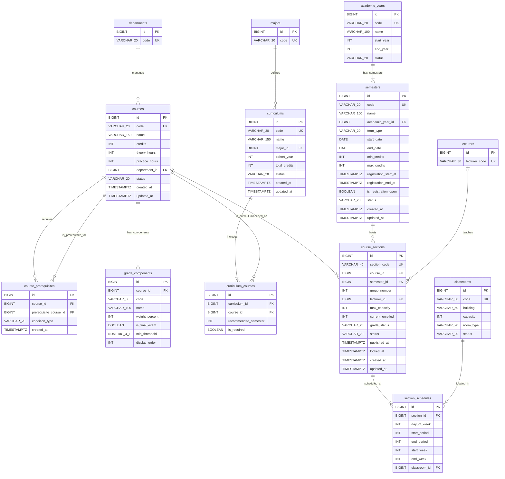
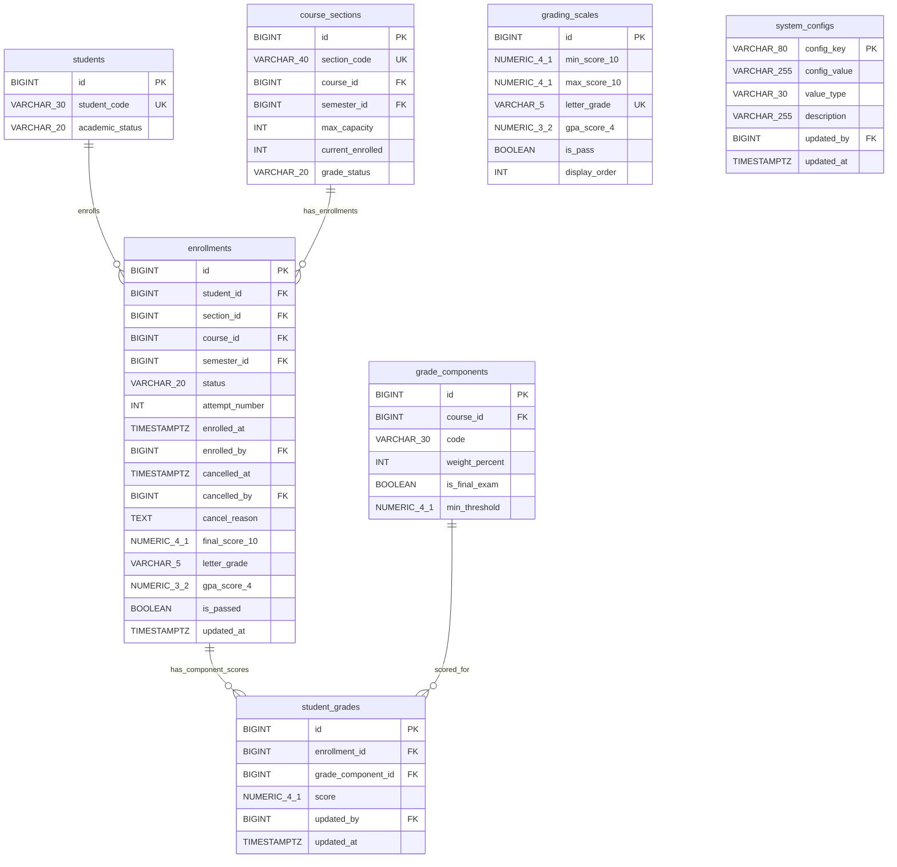
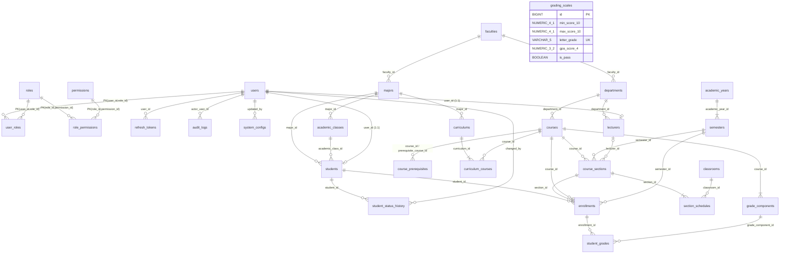

# GIAI ĐOẠN 4 (PHẦN 1): PHÂN TÍCH ENTITY, CONCEPTUAL MODEL, LOGICAL MODEL & HỆ THỐNG SƠ ĐỒ ERD

> [!IMPORTANT]
> **Giai đoạn 4 (Database Design) là phần ưu tiên cao nhất của toàn bộ dự án** theo mục 7 của [Planning.md](file:///f:/QUẢN-LÝ-SINH-VIÊN-2/Planning.md#L432-L638).
> Toàn bộ 4 file trong thư mục `docs/03-database/` tuân thủ quy tắc **nhất quán tuyệt đối 100%**: tên bảng, tên cột, kiểu dữ liệu, khóa chính (PK), khóa ngoại (FK) và ràng buộc (Constraints) trong **ERD**, **Physical Model / Data Dictionary** và **SQL DDL (`04-POSTGRESQL-SCHEMA-AND-SEED.sql`)** khớp nhau từng ký tự.

---

## 1. PHÂN TÍCH ENTITY TỪ NGHIỆP VỤ (MỤC 7.1)

Hệ thống gồm **28 bảng (Entities & Junction Tables)** chia thành **6 phân hệ dữ liệu**. Dưới đây là giải thích lý do từng Entity phải tồn tại và nghiệp vụ nào sử dụng nó:

### 1.1. Phân hệ 1: Quản lý Tài khoản & Phân quyền RBAC (6 bảng)
| STT | Tên bảng (Entity) | Tại sao phải tồn tại? | Nghiệp vụ / FR sử dụng |
|---|---|---|---|
| 1 | `users` | Lưu thông tin định danh đăng nhập (`username`, `email`, `password_hash`, `status`) tách biệt khỏi thông tin học vụ của Sinh viên hay Giảng viên. Giúp cơ chế xác thực (Spring Security) làm việc thống nhất cho mọi loại người dùng. | `FR-AUTH-01` → `05` |
| 2 | `roles` | Định nghĩa các vai trò trong hệ thống (`ADMIN`, `ACADEMIC_AFFAIRS`, `LECTURER`, `STUDENT`) và cho phép mở rộng vai trò mới trong tương lai mà không phải sửa cấu trúc bảng `users`. | `FR-AUTH-06` |
| 3 | `permissions` | Định nghĩa các quyền thao tác hạt mịn (`STUDENT_WRITE`, `ENROLLMENT_SELF`, `GRADE_PUBLISH`...) để kiểm soát truy cập API ở Backend. | `FR-AUTH-06` |
| 4 | `user_roles` | Bảng trung gian giải quyết quan hệ `N:M` giữa `users` và `roles` (một người dùng có thể kiêm nhiệm nhiều vai trò, ví dụ vừa là Giảng viên vừa là Cán bộ đào tạo). | `FR-AUTH-01`, `FR-AUTH-06` |
| 5 | `role_permissions` | Bảng trung gian giải quyết quan hệ `N:M` giữa `roles` và `permissions`. | `FR-AUTH-06` |
| 6 | `refresh_tokens` | Lưu bản băm (`token_hash`) và trạng thái thu hồi (`revoked_at`) của các Refresh Token. Nếu không có bảng này, hệ thống sẽ không thể **thu hồi phiên đăng nhập ngay lập tức** khi Admin khóa tài khoản hoặc khi người dùng đổi mật khẩu (`BR-02`). | `FR-AUTH-01` → `05` |

### 1.2. Phân hệ 2: Cơ cấu Tổ chức & Hồ sơ Giảng viên (5 bảng)
| STT | Tên bảng (Entity) | Tại sao phải tồn tại? | Nghiệp vụ / FR sử dụng |
|---|---|---|---|
| 7 | `faculties` | Lưu danh mục Khoa đào tạo (ví dụ: Khoa CNTT 1, Khoa Viễn thông 1) — cấp quản lý cao nhất của bộ môn và ngành học. | `FR-ORG-01` |
| 8 | `departments` | Lưu danh mục Bộ môn chuyên môn thuộc Khoa (`BR-06`, `D-21`), là đơn vị trực tiếp quản lý chuyên môn của Giảng viên và Học phần. | `FR-ORG-01`, `FR-CRS-01` |
| 9 | `majors` | Lưu danh mục Ngành đào tạo thuộc Khoa (ví dụ: Công nghệ thông tin `DCCN`, An toàn thông tin `DCAT`) kèm tổng số tín chỉ yêu cầu tốt nghiệp. | `FR-ORG-02`, `FR-CUR-01` |
| 10 | `academic_classes` | Lưu Lớp hành chính/niên chế (`D22CQCN01-B`) gắn với một Ngành và một Khóa nhập học (`cohort_year`), dùng để quản lý sinh viên theo đơn vị lớp cố định suốt khóa học (khác hoàn toàn với Lớp học phần `course_sections` thay đổi theo từng kỳ). | `FR-ORG-03`, `FR-STU-01` |
| 11 | `lecturers` | Lưu hồ sơ học hàm, học vị, mã giảng viên và bộ môn công tác của Giảng viên, liên kết `1:1` với tài khoản `users` (`BR-04`). | `FR-ORG-04`, `FR-SEC-02`, `FR-GRD-01` |

### 1.3. Phân hệ 3: Quản lý Hồ sơ & Trạng thái Sinh viên (2 bảng)
| STT | Tên bảng (Entity) | Tại sao phải tồn tại? | Nghiệp vụ / FR sử dụng |
|---|---|---|---|
| 12 | `students` | Lưu toàn bộ thông tin lý lịch, liên lạc và thông tin học vụ (`student_code`, `academic_class_id`, `major_id`, `cohort_year`, `academic_status`), liên kết `1:1` với `users`. Việc gộp thông tin lý lịch và học vụ trong 1 bảng `students` chuẩn 3NF giúp tránh phép nối `1:1` không cần thiết trong mọi truy vấn điểm và đăng ký học phần. | `FR-STU-01` → `04`, `FR-ENR-01` |
| 13 | `student_status_history` | Lưu lịch sử mọi lần chuyển đổi trạng thái học vụ (`ACTIVE` ↔ `ON_LEAVE` ↔ `SUSPENDED` → `GRADUATED`/`DROPPED_OUT`) kèm thời điểm, người quyết định và lý do (`BR-08`). | `FR-STU-02` |

### 1.4. Phân hệ 4: Học phần, Tiên quyết & Chương trình đào tạo (5 bảng)
| STT | Tên bảng (Entity) | Tại sao phải tồn tại? | Nghiệp vụ / FR sử dụng |
|---|---|---|---|
| 14 | `courses` | Lưu danh mục Học phần gốc (`INT1306` – Cấu trúc dữ liệu & Giải thuật, số tín chỉ, số giờ LT/TH, bộ môn phụ trách). | `FR-CRS-01` |
| 15 | `course_prerequisites` | Bảng trung gian tự tham chiếu (`Self-Referencing N:M`) trên `courses` để biểu diễn một môn học cần những môn **Tiên quyết (`PREREQUISITE`)** hoặc **Học trước (`COREQUISITE`)** nào (`BR-11`). | `FR-CRS-02`, `FR-ENR-01` |
| 16 | `grade_components` | Lưu cấu hình các đầu điểm thành phần và trọng số (`weight_percent`) của từng học phần (`BR-28`). Nhờ bảng này, mỗi môn học có thể có số lượng đầu điểm và tỷ lệ phần trăm khác nhau mà không bị cố định cột trong bảng điểm. | `FR-CRS-01`, `FR-GRD-01`, `FR-GRD-03` |
| 17 | `curriculums` | Lưu khung Chương trình đào tạo áp dụng cho một cặp `(major_id, cohort_year)` cụ thể (vì chương trình đào tạo của khóa 2022 có thể khác khóa 2024). | `FR-CUR-01`, `FR-CUR-02` |
| 18 | `curriculum_courses` | Bảng trung gian giải quyết quan hệ `N:M` giữa `curriculums` và `courses`, lưu thêm thuộc tính riêng của mối quan hệ là `recommended_semester` (học kỳ khuyến nghị) và `is_required` (bắt buộc/tự chọn) (`BR-13`). | `FR-CUR-01`, `FR-CUR-02` |

### 1.5. Phân hệ 5: Niên lịch Học kỳ, Lớp học phần & Thời khóa biểu (5 bảng)
| STT | Tên bảng (Entity) | Tại sao phải tồn tại? | Nghiệp vụ / FR sử dụng |
|---|---|---|---|
| 19 | `academic_years` | Lưu Năm học (`2025-2026`, `2026-2027`). | `FR-SEM-01` |
| 20 | `semesters` | Lưu Học kỳ (`20261`, `20262`, `20263`) thuộc Năm học, kèm cấu hình giới hạn tín chỉ (`min_credits`, `max_credits`) và khoảng thời gian mở đợt đăng ký học phần (`registration_start_at`, `registration_end_at`, `is_registration_open`). | `FR-SEM-01`, `FR-SEM-02`, `FR-ENR-01` |
| 21 | `classrooms` | Lưu danh mục Phòng học và sức chứa (`capacity`) để kiểm tra sĩ số lớp và chống xếp trùng phòng (`BR-16`). | `FR-SEC-01`, `FR-SEC-02` |
| 22 | `course_sections` | Lưu **Lớp học phần** được mở trong một học kỳ cụ thể (ví dụ nhóm `01` của môn `INT1306` trong kỳ `20261`), giảng viên phụ trách, sĩ số tối đa (`max_capacity`), sĩ số hiện tại (`current_enrolled`) và trạng thái bảng điểm (`grade_status`). Đây là bản ghi được khóa `FOR UPDATE` khi đăng ký học phần. | `FR-SEC-02`, `FR-SEC-03`, `FR-ENR-01`, `FR-GRD-04` |
| 23 | `section_schedules` | Lưu các ca học trong tuần của một lớp học phần `(day_of_week, start_period, end_period, start_week, end_week, classroom_id)` vì 1 lớp học phần có thể học nhiều buổi/tuần ở các phòng khác nhau (ví dụ Thứ 2 học lý thuyết ở phòng `401-A2`, Thứ 5 học thực hành ở phòng Lab `302-A3`). | `FR-SEC-02`, `FR-ENR-01`, `FR-SCH-01`, `FR-SCH-02` |

### 1.6. Phân hệ 6: Đăng ký học phần, Điểm, Cấu hình quy chế & Kiểm toán (5 bảng)
| STT | Tên bảng (Entity) | Tại sao phải tồn tại? | Nghiệp vụ / FR sử dụng |
|---|---|---|---|
| 24 | `enrollments` | Giải quyết quan hệ `N:M` giữa `students` và `course_sections`, đồng thời lưu trạng thái đăng ký (`ENROLLED` / `CANCELLED`), lần học thứ mấy (`attempt_number`) và kết quả tổng kết của sinh viên ở lớp học phần đó (`final_score_10`, `letter_grade`, `gpa_score_4`, `is_passed`). | `FR-ENR-01` → `03`, `FR-GRD-03` → `05` |
| 25 | `student_grades` | Lưu điểm chi tiết từng thành phần điểm (`GradeComponent`) của một lượt đăng ký (`Enrollment`). Giải quyết quan hệ `N:M` giữa `enrollments` và `grade_components`. | `FR-GRD-01`, `FR-GRD-02`, `FR-GRD-03` |
| 26 | `grading_scales` | Lưu bảng quy đổi từ điểm hệ 10 sang điểm chữ (`A`, `B+`, `B`...) và hệ 4 (`4.0`, `3.5`...) để không phải hardcode trong code (`D-05`, `BR-29`). | `FR-GRD-03`, `FR-SYS-01` |
| 27 | `system_configs` | Lưu các tham số quy chế cấp hệ thống (như chính sách tính điểm học lại `RETAKE_POLICY = HIGHEST_SCORE`, điểm liệt mặc định). | `FR-SYS-01` |
| 28 | `audit_logs` | Lưu vết kiểm toán bất biến cho mọi thao tác nhạy cảm (khóa tài khoản, đăng ký/hủy hộ, công bố/khóa/sửa điểm sau khóa) (`BR-32`). | `FR-SYS-02` |

---

## 2. CONCEPTUAL DATA MODEL (MÔ HÌNH DỮ LIỆU KHÁI NIỆM — MỤC 7.2)

### 2.1. Sơ đồ mức khái niệm (Conceptual Diagram)
Ở mức khái niệm, chúng ta nhìn nhận các thực thể nghiệp vụ chính và ý nghĩa mối quan hệ giữa chúng trước khi tách bảng trung gian vật lý:

---

## 3. LOGICAL DATA MODEL & GIẢI QUYẾT QUAN HỆ N:M (MỤC 7.3)

### 3.1. Phân tích toàn bộ các quan hệ `1:1`, `1:N` và `N:M`

| STT | Quan hệ gốc | Loại quan hệ | Cách hiện thực ở Logical Model | Khóa chính / Ràng buộc duy nhất (Unique Constraint) | Optionality (Bắt buộc / Tùy chọn) |
|---|---|---|---|---|---|
| 1 | `users` ↔ `students` | `1 : 0..1` | Cột `user_id` trong `students` | `UNIQUE (user_id)` | Một `Student` bắt buộc có `1` `User`; một `User` có thể không phải là `Student` |
| 2 | `users` ↔ `lecturers` | `1 : 0..1` | Cột `user_id` trong `lecturers` | `UNIQUE (user_id)` | Một `Lecturer` bắt buộc có `1` `User` |
| 3 | `users` ↔ `roles` | `N : M` | Bảng trung gian `user_roles` | `PK (user_id, role_id)` | Mỗi `User` có ít nhất `1` `Role` |
| 4 | `roles` ↔ `permissions` | `N : M` | Bảng trung gian `role_permissions` | `PK (role_id, permission_id)` | Mỗi `Role` có `1..*` `Permission` |
| 5 | `courses` ↔ `courses` (Tiên quyết) | `N : M` (Tự tham chiếu) | Bảng trung gian `course_prerequisites` | `PK (id)`, `UNIQUE (course_id, prerequisite_course_id)` | Một môn có thể có `0..*` môn điều kiện |
| 6 | `curriculums` ↔ `courses` | `N : M` | Bảng trung gian `curriculum_courses` | `PK (id)`, `UNIQUE (curriculum_id, course_id)` | Lưu thêm `recommended_semester`, `is_required` |
| 7 | `students` ↔ `course_sections` | `N : M` | Bảng nghiệp vụ trung gian `enrollments` | `PK (id)`, `UNIQUE (student_id, section_id)` + Partial Unique Index `(student_id, course_id, semester_id) WHERE status = 'ENROLLED'` | Cho phép 1 SV học nhiều lớp học phần và lưu toàn bộ lịch sử đăng ký + kết quả tổng kết |
| 8 | `enrollments` ↔ `grade_components` | `N : M` | Bảng trung gian `student_grades` | `PK (id)`, `UNIQUE (enrollment_id, grade_component_id)` | Lưu điểm số (`score`) của từng thành phần điểm cho từng sinh viên trong lớp |

---

## 4. HỆ THỐNG SƠ ĐỒ ERD (MỤC 7.5 & 9.3.6)

> [!TIP]
> Để vừa đảm bảo khả năng đọc rõ ràng từng cột PK/FK, vừa thấy được bức tranh toàn cục theo đúng mục 7.5 của `Planning.md`:
> - **Mục 4.1 → 4.4:** 4 sơ đồ **ERD chi tiết theo từng phân hệ** (hiển thị đầy đủ 100% các cột, kiểu dữ liệu, PK/FK/UK của cả 28 bảng).
> - **Mục 4.5:** **ERD Tổng thể toàn hệ thống** ghép nối toàn bộ 28 bảng với tên bảng và khóa chính/khóa ngoại thống nhất tuyệt đối.

---

### 4.1. ERD Phân hệ 1: Authentication, Authorization (RBAC) & Audit Log (7 bảng — Bắt buộc Mục 9.3.6)

---

### 4.2. ERD Phân hệ 2: Cơ cấu Tổ chức, Giảng viên & Hồ sơ Sinh viên (7 bảng + liên kết `users`)

---

### 4.3. ERD Phân hệ 3: Học phần, Tiên quyết, Chương trình đào tạo, Học kỳ & Lớp học phần (10 bảng)

---

### 4.4. ERD Phân hệ 4: Đăng ký học phần, Điểm & Cấu hình Thang điểm (4 bảng + bảng liên kết)

---

### 4.5. ERD Tổng thể Toàn hệ thống (Master ERD — 28 Bảng)

Sơ đồ dưới đây kết nối toàn bộ 28 bảng của 4 sơ đồ phân hệ trên thành một mô hình tổng thể duy nhất:

