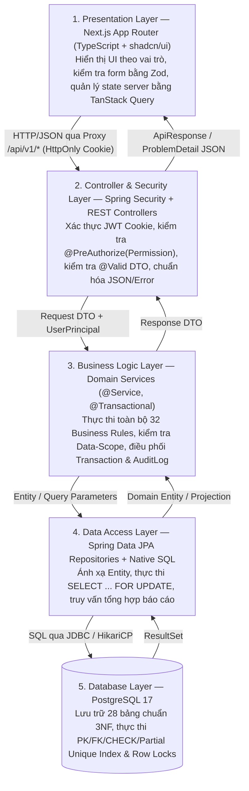

# GIAI ĐOẠN 6: SYSTEM ARCHITECTURE, SECURITY DESIGN & RESTFUL API SPECIFICATION

> [!NOTE]
> Tài liệu này thực hiện đầy đủ mục **9.1 (System Architecture)**, **9.2 (API Design)**, **9.3 (Security Design — Authentication & Authorization)** và **9.4 (Luồng xử lý thực tế)** của [Planning.md](file:///f:/QUẢN-LÝ-SINH-VIÊN-2/Planning.md#L733-L909).

---

## 1. SYSTEM ARCHITECTURE — KIẾN TRÚC PHÂN TẦNG 5 LỚP (MỤC 9.1)

Bên trong mỗi Module nghiệp vụ của kiến trúc **Modular Monolith**, hệ thống tuân thủ kiến trúc phân tầng **5 lớp (5-Layer Architecture)** với nguyên tắc phụ thuộc một chiều từ trên xuống dưới:



### Nhiệm vụ cụ thể của từng tầng
1. **Presentation Layer (Next.js):** Chỉ chịu trách nhiệm hiển thị giao diện Tiếng Việt, kiểm tra dữ liệu nhập sơ bộ ở phía trình duyệt để phản hồi nhanh cho người dùng, gọi API qua `/api/v1/*` và hiển thị kết quả/thông báo lỗi. **Không chứa logic nghiệp vụ hay quy tắc tính điểm/kiểm tra điều kiện đăng ký.**
2. **Controller / API Layer (`@RestController`):** Tiếp nhận HTTP Request, giải mã người dùng từ `SecurityContext`, kiểm tra định dạng dữ liệu đầu vào bằng `@Valid` (Bean Validation), gọi xuống `Service` và đóng gói kết quả vào cấu trúc JSON chuẩn. **Không viết câu lệnh SQL hay logic nghiệp vụ trong Controller.**
3. **Business Logic Layer (`@Service`):** Là "trái tim" của hệ thống. Quản lý ranh giới giao dịch (`@Transactional`), kiểm tra quyền sở hữu dữ liệu (`Data-Scope`), thực thi toàn bộ 32 quy tắc nghiệp vụ (`BR-01` → `BR-32`) và ghi `AuditLog`.
4. **Data Access Layer (`@Repository`):** Giao tiếp với cơ sở dữ liệu thông qua Spring Data JPA / JPQL (cho các thao tác đọc/ghi thực thể và khóa dòng `@Lock(PESSIMISTIC_WRITE)`) và Native SQL (cho các truy vấn thống kê báo cáo phức tạp).
5. **Database Layer (PostgreSQL):** Chốt chặn cuối cùng bảo vệ tính toàn vẹn dữ liệu bằng ACID Transaction, Row-level Locking, Foreign Key, Check Constraint và Partial Unique Index.

---

## 2. SECURITY DESIGN — THIẾT KẾ BẢO MẬT TOÀN DIỆN (MỤC 9.3)

### 2.1. Authentication & Quản lý phiên (`HttpOnly` Cookie + Token Rotation)
1. **Password Hashing (`BR-01`):** Sử dụng `BCryptPasswordEncoder` (strength = `10` hoặc `12`). Mỗi mật khẩu tự động có `salt` ngẫu nhiên riêng biệt; không bao giờ lưu mật khẩu dạng rõ (plaintext) trong DB hay file log.
2. **Cơ chế Token kép trong `HttpOnly` Cookie (`D-23`):**
   - `access_token`: JWT có thời hạn ngắn (**15 phút**), ký bằng thuật toán `HMAC-SHA256` (`HS256`) với khóa bí mật `>= 256-bit`, chứa `sub` (`userId`), `username`, `roles` và danh sách `permissions`.
   - `refresh_token`: Chuỗi ngẫu nhiên mật mã học 256-bit có thời hạn **7 ngày**. Hệ thống chỉ lưu **bản băm SHA-256** (`token_hash`) vào bảng `refresh_tokens`.
   - Cả hai token được gửi xuống trình duyệt qua header `Set-Cookie` với các cờ bảo mật: `HttpOnly; SameSite=Lax; Path=/` (bật thêm `Secure` khi chạy HTTPS).
3. **Thu hồi phiên tức thì (`BR-02`):**
   - Khi Admin khóa tài khoản (`status = 'LOCKED'`), hoặc khi người dùng đổi/đặt lại mật khẩu: Backend chạy lệnh `UPDATE refresh_tokens SET revoked_at = NOW(), revoked_reason = '...' WHERE user_id = :userId AND revoked_at IS NULL`.

### 2.2. Authorization 2 Lớp: RBAC + Data-Scope Authorization (`BR-03`)
- **Lớp 1 — Kiểm tra quyền chức năng (RBAC):** Trên từng method của Controller sử dụng `@PreAuthorize("hasAuthority('PERMISSION_CODE')")`. Nếu thiếu quyền, Spring Security trả về ngay `HTTP 403 FORBIDDEN`.
- **Lớp 2 — Kiểm tra phạm vi dữ liệu (Data-Scope tại Service):**
  - **Với Sinh viên (`STUDENT`):** Mọi API của sinh viên (`/api/v1/students/me/*`, `/api/v1/enrollments`) đều tự động trích xuất `userId` từ JWT (`@AuthenticationPrincipal UserPrincipal principal`) rồi ánh xạ sang `studentId` trong DB; **không nhận `studentId` từ URL hay Request Body** để triệt tiêu hoàn toàn lỗ hổng IDOR (Insecure Direct Object Reference).
  - **Với Giảng viên (`LECTURER`):** Khi giảng viên xem danh sách sinh viên, nhập điểm hoặc công bố điểm của `sectionId`, `GradeService` bắt buộc kiểm tra `section.getLecturer().getUser().getId().equals(currentUserId)`. Nếu không khớp → ném `AccessDeniedException` (`HTTP 403 GRADE_NOT_ASSIGNED_LECTURER`).

### 2.3. Phòng chống các lỗ hổng bảo mật Web phổ biến (OWASP Top 10)
| Lỗ hổng / Mối đe dọa | Giải pháp kỹ thuật áp dụng trong dự án |
|---|---|
| **SQL Injection (SQLi)** | 100% truy vấn JPA/JPQL và Native SQL sử dụng **Parameterized Queries** (`:paramName` hoặc `?`), tuyệt đối không nối chuỗi SQL từ đầu vào người dùng. |
| **Cross-Site Scripting (XSS)** | React/Next.js tự động escape nội dung hiển thị; Token đặt trong `HttpOnly` Cookie nên JavaScript độc hại không thể đọc được `document.cookie`; cấu hình header `Content-Security-Policy` và `X-Content-Type-Options: nosniff`. |
| **Cross-Site Request Forgery (CSRF)** | Kết hợp Next.js Proxy (cùng origin), cờ `SameSite=Lax` trên Cookie và bắt buộc custom header `X-Requested-With: XMLHttpRequest` (hoặc CSRF Double-Submit Cookie Token) cho mọi request `POST/PUT/PATCH/DELETE` (trình duyệt chặn form HTML cross-site gửi custom header). |
| **Brute-force Login & Spam API (Rate Limiting)** | Áp dụng bộ giới hạn tần suất (Rate Limiter bằng Bucket4j / In-memory cache theo IP) trên endpoint `/api/v1/auth/login` và `/api/v1/auth/forgot-password` (tối đa `10` lần thử / phút / IP; vượt ngưỡng trả `HTTP 429 TOO_MANY_REQUESTS`). |
| **Input Validation** | Kiểm tra 2 đầu: Zod Schema tại Frontend Next.js và Jakarta Bean Validation (`@NotNull`, `@NotBlank`, `@Size`, `@Min`, `@Max`, `@Email`, `@Pattern`) tại Backend DTO. |
| **Audit Logging (`BR-32`)** | Mọi hành động nhạy cảm (khóa tài khoản, thay đổi quyền, đăng ký/hủy hộ, công bố/khóa/sửa điểm sau khóa) đều ghi bản ghi bất biến vào bảng `audit_logs` kèm `old_value_json`, `new_value_json`, `reason`, `ip_address`. |

---

## 3. RESTFUL API DESIGN — ĐẶC TẢ CHI TIẾT CÁC ENDPOINT (MỤC 9.2)

### 3.1. Chuẩn hóa Cấu trúc Response & Mã lỗi (Standard Envelope)

#### Khi thành công (`HTTP 200 OK` / `201 Created`):
```json
{
  "success": true,
  "data": { ... },
  "timestamp": "2026-11-18T12:00:00Z"
}
```

#### Khi thất bại (`HTTP 400 / 401 / 403 / 404 / 409 / 429 / 500`):
```json
{
  "success": false,
  "error": {
    "code": "ENROLL_SCHEDULE_CONFLICT",
    "message": "Trùng lịch học tại Thứ 2 (Tiết 1-3, Tuần 1-15) với lớp học phần INT1154-20261-01",
    "details": [
      { "field": "sectionId", "issue": "Conflicting with section INT1154-20261-01" }
    ]
  },
  "timestamp": "2026-11-18T12:00:00Z"
}
```

---

### 3.2. Danh mục đầy đủ RESTful API theo 8 Module

#### Module 1: Authentication & RBAC (`/api/v1/auth`, `/api/v1/admin`)

| Method & Endpoint | Mục đích | Quyền yêu cầu (Authorization) | Request Body / Params & Validation | Response (`200`/`201`) | Mã lỗi nghiệp vụ chính |
|---|---|---|---|---|---|
| `POST /api/v1/auth/login` | Đăng nhập & nhận `HttpOnly` Cookie (`FR-AUTH-01`) | Public (Rate limited) | `{ usernameOrEmail: @NotBlank, password: @NotBlank }` | `UserProfileDto` + `Set-Cookie` | `401 AUTH_INVALID_CREDENTIALS`, `403 AUTH_ACCOUNT_LOCKED`, `429 TOO_MANY_REQUESTS` |
| `POST /api/v1/auth/refresh` | Làm mới Access Token (`FR-AUTH-02`) | Cookie `refresh_token` | Đọc `refresh_token` từ Cookie | `Set-Cookie` cặp token mới | `401 AUTH_REFRESH_TOKEN_INVALID`, `403 AUTH_ACCOUNT_LOCKED` |
| `POST /api/v1/auth/logout` | Đăng xuất & thu hồi Refresh Token (`FR-AUTH-02`) | Authenticated | Đọc `refresh_token` từ Cookie | `{ message: "Đã đăng xuất" }` + Xóa Cookie | `401 UNAUTHORIZED` |
| `GET /api/v1/auth/me` | Lấy thông tin phiên đăng nhập hiện tại | Authenticated | — | `UserProfileDto (id, username, email, roles, permissions)` | `401 UNAUTHORIZED` |
| `PUT /api/v1/auth/change-password` | Đổi mật khẩu cá nhân (`FR-AUTH-03`) | Authenticated | `{ currentPassword: @NotBlank, newPassword: @Size(min=8), confirmPassword: @NotBlank }` | `{ message: "Đổi mật khẩu thành công" }` | `400 AUTH_WRONG_CURRENT_PASSWORD`, `400 VALIDATION_ERROR` |
| `POST /api/v1/auth/forgot-password` | Yêu cầu gửi email đặt lại mật khẩu (`FR-AUTH-04`) | Public (Rate limited) | `{ email: @Email @NotBlank }` | `{ message: "Nếu email tồn tại, hướng dẫn đã được gửi" }` | `400 VALIDATION_ERROR` |
| `POST /api/v1/auth/reset-password` | Đặt lại mật khẩu bằng token email (`FR-AUTH-04`) | Public | `{ token: @NotBlank, newPassword: @Size(min=8) }` | `{ message: "Đặt lại mật khẩu thành công" }` | `400 AUTH_RESET_TOKEN_EXPIRED` |
| `GET /api/v1/admin/users` | Danh sách tài khoản (phân trang, lọc) (`FR-AUTH-05`) | `USER_READ` | `?keyword=&role=&status=&page=0&size=20` | `PageResponse<UserSummaryDto>` | `403 FORBIDDEN` |
| `PATCH /api/v1/admin/users/{id}/status` | Khóa / Mở khóa tài khoản & thu hồi token (`FR-AUTH-05`) | `USER_LOCK` | `{ status: 'ACTIVE'\|'LOCKED', reason: @NotBlank }` | `UserSummaryDto` | `400 CANNOT_LOCK_SELF`, `404 USER_NOT_FOUND` |
| `GET /api/v1/admin/roles` | Xem danh sách Role & Permission (`FR-AUTH-06`) | `RBAC_MANAGE` | — | `List<RoleDetailDto>` | `403 FORBIDDEN` |
| `PUT /api/v1/admin/roles/{id}/permissions` | Cập nhật danh sách Permission của Role (`FR-AUTH-06`) | `RBAC_MANAGE` | `{ permissionIds: @NotEmpty List<Long> }` | `RoleDetailDto` | `404 ROLE_NOT_FOUND` |
| `GET /api/v1/admin/audit-logs` | Tra cứu Nhật ký kiểm toán (`FR-SYS-02`) | `AUDIT_READ` | `?actorUserId=&action=&entityType=&from=&to=&page=0&size=20` | `PageResponse<AuditLogDto>` | `403 FORBIDDEN` |

---

#### Module 2: Cơ cấu Tổ chức & Giảng viên (`/api/v1/faculties`, `/api/v1/departments`, `/api/v1/majors`, `/api/v1/academic-classes`, `/api/v1/lecturers`)

| Method & Endpoint | Mục đích | Quyền yêu cầu | Request Body / Params & Validation | Response | Mã lỗi nghiệp vụ chính |
|---|---|---|---|---|---|
| `GET /api/v1/faculties` | Danh sách Khoa (`FR-ORG-01`) | `ORG_READ` | `?status=ACTIVE` | `List<FacultyDto>` | — |
| `POST /api/v1/faculties` | Tạo mới Khoa (`FR-ORG-01`) | `ORG_WRITE` | `{ code: @NotBlank @Size(max=20), name: @NotBlank, description }` | `FacultyDto` (`201`) | `409 FACULTY_CODE_EXISTS` |
| `PUT /api/v1/faculties/{id}` | Cập nhật Khoa | `ORG_WRITE` | `{ name: @NotBlank, description, status }` | `FacultyDto` | `404 FACULTY_NOT_FOUND` |
| `GET /api/v1/departments` | Danh sách Bộ môn (`FR-ORG-01`) | `ORG_READ` | `?facultyId=&status=` | `List<DepartmentDto>` | — |
| `POST /api/v1/departments` | Tạo mới Bộ môn | `ORG_WRITE` | `{ code: @NotBlank, name: @NotBlank, facultyId: @NotNull }` | `DepartmentDto` (`201`) | `409 DEPARTMENT_CODE_EXISTS`, `404 FACULTY_NOT_FOUND` |
| `GET /api/v1/majors` | Danh sách Ngành đào tạo (`FR-ORG-02`) | `ORG_READ` | `?facultyId=&status=` | `List<MajorDto>` | — |
| `POST /api/v1/majors` | Tạo mới Ngành đào tạo | `ORG_WRITE` | `{ code: @NotBlank, name: @NotBlank, facultyId: @NotNull, totalCreditsRequired: @Min(1) }` | `MajorDto` (`201`) | `409 MAJOR_CODE_EXISTS` |
| `GET /api/v1/academic-classes` | Danh sách Lớp hành chính (`FR-ORG-03`) | `ORG_READ` | `?majorId=&cohortYear=` | `List<AcademicClassDto>` | — |
| `POST /api/v1/academic-classes` | Tạo mới Lớp hành chính | `ORG_WRITE` | `{ code: @NotBlank, name: @NotBlank, majorId: @NotNull, cohortYear: @Min(2000) }` | `AcademicClassDto` (`201`) | `409 ACADEMIC_CLASS_CODE_EXISTS` |
| `GET /api/v1/lecturers` | Danh sách Giảng viên (`FR-ORG-04`) | `ORG_READ` | `?departmentId=&keyword=&page=0&size=20` | `PageResponse<LecturerDto>` | — |
| `POST /api/v1/lecturers` | Tạo Giảng viên + Tài khoản User (`FR-ORG-04`) | `ORG_WRITE` | `{ lecturerCode: @NotBlank, fullName: @NotBlank, email: @Email, departmentId: @NotNull, degree, academicRank, phone }` | `LecturerDto` (`201`) | `409 LECTURER_CODE_OR_EMAIL_EXISTS` |

---

#### Module 3: Quản lý Sinh viên (`/api/v1/students`)

| Method & Endpoint | Mục đích | Quyền yêu cầu | Request Body / Params & Validation | Response | Mã lỗi nghiệp vụ chính |
|---|---|---|---|---|---|
| `GET /api/v1/students` | Tìm kiếm & lọc danh sách Sinh viên (`FR-STU-01`) | `STUDENT_READ` | `?keyword=&majorId=&academicClassId=&cohortYear=&academicStatus=&page=0&size=20` | `PageResponse<StudentSummaryDto>` | `403 FORBIDDEN` |
| `GET /api/v1/students/{id}` | Xem chi tiết hồ sơ 1 Sinh viên (`FR-STU-01`) | `STUDENT_READ` | Path `id` | `StudentDetailDto` (kèm lịch sử trạng thái) | `404 STUDENT_NOT_FOUND` |
| `POST /api/v1/students` | Tạo mới Sinh viên + Tài khoản User (`FR-STU-01`) | `STUDENT_WRITE` | `{ studentCode: @NotBlank, fullName: @NotBlank, dateOfBirth: @Past, gender, nationalId: @NotBlank, email: @Email, academicClassId: @NotNull, majorId: @NotNull, cohortYear: @NotNull, phone, address }` | `StudentDetailDto` (`201`) | `409 STUDENT_DUPLICATE_KEY`, `400 CLASS_MAJOR_MISMATCH` |
| `PUT /api/v1/students/{id}` | Phòng đào tạo cập nhật hồ sơ Sinh viên (`FR-STU-01`) | `STUDENT_WRITE` | `UpdateStudentRequestDto` | `StudentDetailDto` | `404 STUDENT_NOT_FOUND`, `409 DUPLICATE_KEY` |
| `PATCH /api/v1/students/{id}/academic-status` | Chuyển đổi trạng thái học vụ (`FR-STU-02`) | `STUDENT_WRITE` | `{ newStatus: 'ACTIVE'\|'ON_LEAVE'\|'SUSPENDED'\|'GRADUATED'\|'DROPPED_OUT', reason: @NotBlank }` | `StudentDetailDto` | `400 INVALID_STATUS_TRANSITION` |
| `POST /api/v1/students/import` | Import Sinh viên từ Excel/CSV (`FR-STU-04`) | `STUDENT_WRITE` | `MultipartFile file`, `?dryRun=true\|false` | `ImportResultDto (validCount, errors[])` | `400 IMPORT_VALIDATION_FAILED` |
| `GET /api/v1/students/me` | Sinh viên xem hồ sơ của chính mình (`FR-STU-03`) | `STUDENT_SELF_UPDATE` (Data-Scope: `currentUserId`) | — | `StudentDetailDto` | `401 UNAUTHORIZED` |
| `PATCH /api/v1/students/me/contact` | Sinh viên tự sửa 4 trường liên lạc (`FR-STU-03`) | `STUDENT_SELF_UPDATE` (Data-Scope: `currentUserId`) | `{ phone, personalEmail: @Email, address, avatarUrl }` | `StudentDetailDto` | `400 VALIDATION_ERROR` |

---

#### Module 4: Học phần, Tiên quyết & Chương trình đào tạo (`/api/v1/courses`, `/api/v1/curriculums`)

| Method & Endpoint | Mục đích | Quyền yêu cầu | Request Body / Params & Validation | Response | Mã lỗi nghiệp vụ chính |
|---|---|---|---|---|---|
| `GET /api/v1/courses` | Tra cứu danh mục Học phần (`FR-CRS-01`) | `COURSE_READ` | `?keyword=&departmentId=&status=&page=0&size=20` | `PageResponse<CourseDto>` | — |
| `POST /api/v1/courses` | Tạo Học phần kèm Thành phần điểm (`FR-CRS-01`) | `COURSE_WRITE` | `{ code: @NotBlank, name: @NotBlank, credits: @Min(1), theoryHours, practiceHours, departmentId: @NotNull, gradeComponents: @NotEmpty List<GradeComponentDto> }` | `CourseDetailDto` (`201`) | `409 COURSE_CODE_EXISTS`, `400 GRADE_WEIGHT_SUM_NOT_100` |
| `PUT /api/v1/courses/{id}/prerequisites` | Cập nhật danh sách môn Tiên quyết / Học trước (`FR-CRS-02`) | `COURSE_WRITE` | `{ prerequisites: [{ prerequisiteCourseId: @NotNull, conditionType: 'PREREQUISITE'\|'COREQUISITE' }] }` | `List<PrerequisiteDto>` | `400 PREREQUISITE_CYCLE_DETECTED` |
| `GET /api/v1/curriculums` | Danh sách Chương trình đào tạo (`FR-CUR-01`) | `COURSE_READ` | `?majorId=&cohortYear=` | `List<CurriculumDto>` | — |
| `POST /api/v1/curriculums` | Tạo Chương trình đào tạo & gán môn học (`FR-CUR-01`) | `COURSE_WRITE` | `{ code: @NotBlank, name: @NotBlank, majorId: @NotNull, cohortYear: @NotNull, courses: List<CurriculumCourseItemDto> }` | `CurriculumDetailDto` (`201`) | `409 CURRICULUM_ALREADY_EXISTS` |
| `GET /api/v1/students/me/curriculum-progress` | Sinh viên xem CTĐT & tiến độ hoàn thành (`FR-CUR-02`) | `RESULT_READ_SELF` (Data-Scope: `currentUserId`) | — | `CurriculumProgressDto` | — |

---

#### Module 5: Học kỳ, Phòng học, Lớp học phần & Thời khóa biểu (`/api/v1/semesters`, `/api/v1/classrooms`, `/api/v1/sections`, `/api/v1/schedules`)

| Method & Endpoint | Mục đích | Quyền yêu cầu | Request Body / Params & Validation | Response | Mã lỗi nghiệp vụ chính |
|---|---|---|---|---|---|
| `GET /api/v1/semesters` | Danh sách Năm học & Học kỳ (`FR-SEM-01`) | `SECTION_READ` | — | `List<SemesterDto>` | — |
| `POST /api/v1/semesters` | Tạo mới Học kỳ kèm giới hạn tín chỉ (`FR-SEM-01`) | `SEMESTER_WRITE` | `{ code, name, academicYearId, termType, startDate, endDate, minCredits, maxCredits, registrationStartAt, registrationEndAt }` | `SemesterDto` (`201`) | `400 INVALID_DATE_OR_CREDIT_RANGE`, `409 SEMESTER_CODE_EXISTS` |
| `PATCH /api/v1/semesters/{id}/registration-period` | Cấu hình & Đóng/Mở đợt đăng ký (`FR-SEM-02`) | `SEMESTER_WRITE` | `{ registrationStartAt, registrationEndAt, isRegistrationOpen: @NotNull }` | `SemesterDto` | `400 INVALID_REGISTRATION_WINDOW` |
| `GET /api/v1/classrooms` | Danh sách Phòng học (`FR-SEC-01`) | `SECTION_READ` | `?building=&roomType=&minCapacity=` | `List<ClassroomDto>` | — |
| `POST /api/v1/classrooms` | Tạo mới Phòng học (`FR-SEC-01`) | `SECTION_WRITE` | `{ code: @NotBlank, building: @NotBlank, capacity: @Min(1), roomType }` | `ClassroomDto` (`201`) | `409 CLASSROOM_CODE_EXISTS` |
| `GET /api/v1/sections` | Tra cứu danh sách Lớp học phần mở trong kỳ (`FR-SEC-03`) | `SECTION_READ` | `?semesterId=&courseId=&lecturerId=&keyword=&page=0&size=20` | `PageResponse<CourseSectionDto>` | — |
| `POST /api/v1/sections` | Mở Lớp học phần, phân công GV & xếp lịch (`FR-SEC-02`) | `SECTION_WRITE` | `{ courseId: @NotNull, semesterId: @NotNull, groupNumber: @Min(1), lecturerId, maxCapacity: @Min(1), schedules: @NotEmpty List<ScheduleItemDto> }` | `CourseSectionDetailDto` (`201`) | `400 CLASSROOM_CAPACITY_EXCEEDED`, `409 SCHEDULE_CLASSROOM_CONFLICT`, `409 SCHEDULE_LECTURER_CONFLICT`, `409 SECTION_GROUP_EXISTS` |
| `GET /api/v1/sections/{id}/students` | Xem danh sách SV đã đăng ký trong Lớp học phần (`FR-SEC-03`) | `SECTION_WRITE` hoặc `GRADE_WRITE` (Data-Scope: GV phụ trách lớp) | Path `id` | `List<SectionStudentRosterDto>` | `403 ACCESS_DENIED_DATA_SCOPE`, `404 SECTION_NOT_FOUND` |
| `GET /api/v1/schedules/me` | Xem Thời khóa biểu cá nhân của SV hoặc GV (`FR-SCH-01`, `FR-SCH-02`) | Authenticated (`STUDENT` / `LECTURER`) | `?semesterId=&weekNumber=` | `PersonalTimetableDto` | — |

---

#### Module 6: Đăng ký Học phần (`/api/v1/enrollments`) — Trọng tâm Transaction & Concurrency

| Method & Endpoint | Mục đích | Quyền yêu cầu | Request Body / Params & Validation | Response | Mã lỗi nghiệp vụ chính |
|---|---|---|---|---|---|
| `GET /api/v1/enrollments/me` | Sinh viên xem danh sách học phần đã đăng ký trong kỳ | `ENROLLMENT_SELF` (Data-Scope: `currentUserId`) | `?semesterId=` | `StudentSemesterEnrollmentDto (totalCredits, minCredits, maxCredits, items[])` | — |
| `POST /api/v1/enrollments` | Sinh viên tự đăng ký Lớp học phần (`FR-ENR-01`) | `ENROLLMENT_SELF` (Data-Scope: `currentUserId`) | `{ sectionId: @NotNull }` | `EnrollmentResponseDto` (`201`) | `403 ENROLL_STUDENT_NOT_ACTIVE`, `400 ENROLL_PERIOD_CLOSED`, `409 ENROLL_SECTION_FULL`, `409 ENROLL_DUPLICATE_COURSE_IN_SEMESTER`, `400 ENROLL_PREREQUISITE_NOT_MET`, `400 ENROLL_MAX_CREDITS_EXCEEDED`, `409 ENROLL_SCHEDULE_CONFLICT` |
| `DELETE /api/v1/enrollments/{id}` | Sinh viên tự hủy đăng ký học phần trong đợt mở (`FR-ENR-02`) | `ENROLLMENT_SELF` (Data-Scope: sở hữu `enrollmentId`) | Path `id` | `{ message: "Đã hủy đăng ký học phần" }` (`200`) | `400 ENROLL_PERIOD_CLOSED`, `403 ACCESS_DENIED_DATA_SCOPE`, `404 ENROLLMENT_NOT_FOUND` |
| `POST /api/v1/enrollments/override` | Phòng đào tạo đăng ký / hủy học phần hộ SV (`FR-ENR-03`) | `ENROLLMENT_OVERRIDE` | `{ studentId: @NotNull, sectionId: @NotNull, action: 'ENROLL'\|'CANCEL', reason: @NotBlank }` | `EnrollmentResponseDto` | `400 REASON_REQUIRED`, `409 ENROLL_SECTION_FULL`, `409 ENROLL_SCHEDULE_CONFLICT` |

---

#### Module 7: Quản lý Điểm & Kết quả học tập (`/api/v1/sections/{id}/grades`, `/api/v1/students/me/academic-results`)

| Method & Endpoint | Mục đích | Quyền yêu cầu | Request Body / Params & Validation | Response | Mã lỗi nghiệp vụ chính |
|---|---|---|---|---|---|
| `GET /api/v1/sections/{sectionId}/grades` | Xem bảng điểm Lớp học phần (`FR-GRD-01`) | `GRADE_WRITE` (GV phụ trách lớp) hoặc `GRADE_LOCK` (PĐT) | Path `sectionId` | `SectionGradeBookDto (gradeStatus, components[], studentRows[])` | `403 GRADE_NOT_ASSIGNED_LECTURER` |
| `PUT /api/v1/sections/{sectionId}/grades` | Giảng viên lưu điểm thành phần & tính tự động điểm tổng kết (`FR-GRD-01`, `FR-GRD-03`) | `GRADE_WRITE` (Data-Scope: GV phụ trách lớp & `grade_status == DRAFT`) | `{ rows: [{ enrollmentId: @NotNull, scores: [{ gradeComponentId: @NotNull, score: @DecimalMin("0.0") @DecimalMax("10.0") }] }] }` | `SectionGradeBookDto` | `403 GRADE_NOT_ASSIGNED_LECTURER`, `400 GRADE_ALREADY_PUBLISHED_OR_LOCKED`, `400 INVALID_SCORE_RANGE` |
| `POST /api/v1/sections/{sectionId}/grades/import` | Import bảng điểm Lớp học phần từ Excel (`FR-GRD-02`) | `GRADE_WRITE` (Data-Scope: GV phụ trách & `DRAFT`) | `MultipartFile file`, `?dryRun=true\|false` | `ImportGradeResultDto` | `400 IMPORT_VALIDATION_FAILED` |
| `POST /api/v1/sections/{sectionId}/grades/publish` | Công bố bảng điểm (`DRAFT → PUBLISHED`) (`FR-GRD-04`) | `GRADE_PUBLISH` (GV phụ trách hoặc PĐT) | Path `sectionId` | `SectionGradeBookDto` | `400 GRADE_INCOMPLETE_FOR_PUBLISH` |
| `POST /api/v1/sections/{sectionId}/grades/lock` | Phòng đào tạo khóa sổ điểm (`PUBLISHED → LOCKED`) (`FR-GRD-04`) | `GRADE_LOCK` | Path `sectionId` | `SectionGradeBookDto` | `400 GRADE_MUST_BE_PUBLISHED_FIRST` |
| `PATCH /api/v1/enrollments/{enrollmentId}/grades/override` | Phòng đào tạo sửa điểm sau khi đã công bố/khóa kèm lý do (`FR-GRD-04`) | `GRADE_LOCK` | `{ scores: List<ComponentScoreDto>, reason: @NotBlank }` | `StudentGradeRowDto` | `400 REASON_REQUIRED` |
| `GET /api/v1/students/me/academic-results` | Sinh viên xem điểm các kỳ, GPA học kỳ & CPA tích lũy (`FR-GRD-05`) | `RESULT_READ_SELF` (Data-Scope: `currentUserId`) | — | `AcademicTranscriptDto` | — |
| `GET /api/v1/students/{studentId}/academic-results` | Phòng đào tạo xem bảng điểm & GPA/CPA của 1 sinh viên (`FR-GRD-05`) | `STUDENT_READ` | Path `studentId` | `AcademicTranscriptDto` | `404 STUDENT_NOT_FOUND` |

---

#### Module 8: Báo cáo Thống kê & Cấu hình Quy chế (`/api/v1/reports`, `/api/v1/system-configs`)

| Method & Endpoint | Mục đích | Quyền yêu cầu | Request Body / Params | Response |
|---|---|---|---|---|
| `GET /api/v1/reports/student-statistics` | Thống kê quân số sinh viên theo Khoa/Ngành/Trạng thái (`FR-RPT-01`) | `REPORT_READ` | `?facultyId=&cohortYear=` | `StudentStatisticsReportDto` |
| `GET /api/v1/reports/enrollment-capacity` | Thống kê tỷ lệ lấp đầy các lớp học phần trong kỳ (`FR-RPT-01`) | `REPORT_READ` | `?semesterId=` | `SectionCapacityReportDto` |
| `GET /api/v1/reports/grade-distribution` | Thống kê phổ điểm A..F và tỷ lệ qua môn (`FR-RPT-01`) | `REPORT_READ` (GV chỉ xem lớp mình dạy) | `?semesterId=&courseId=&sectionId=` | `GradeDistributionReportDto` |
| `GET /api/v1/system-configs/grading-scales` | Xem bảng thang điểm quy đổi (`FR-SYS-01`) | Authenticated | — | `List<GradingScaleDto>` |
| `PUT /api/v1/system-configs/grading-scales` | Cập nhật bảng thang điểm quy đổi (`FR-SYS-01`) | `RBAC_MANAGE` hoặc `SEMESTER_WRITE` | `{ scales: List<GradingScaleDto> }` | `List<GradingScaleDto>` |

---

## 4. LUỒNG XỬ LÝ THỰC TẾ END-TO-END: NGHIỆP VỤ ĐĂNG KÝ HỌC PHẦN (MỤC 9.4)

Dưới đây là mô tả chi tiết từng bước đường đi của một yêu cầu thực tế khi **Sinh viên `B22DCCN001` bấm nút "Đăng ký" lớp học phần `INT1306-20261-01` (`sectionId = 2`)**:

1. **Bước 1 — User thao tác trên UI:** Sinh viên bấm nút **"Đăng ký"** tại dòng lớp `INT1306-20261-01` trên màn hình Đăng ký học phần của Next.js.
2. **Bước 2 — Frontend Next.js chuẩn bị & gửi HTTP Request:**
   - Mutation của `TanStack Query` vô hiệu hóa tạm thời nút bấm (chống bấm đúp trên giao diện) và gọi:
     `POST /api/v1/enrollments` với body `{ "sectionId": 2 }` và header `X-Requested-With: XMLHttpRequest`.
   - Trình duyệt tự động đính kèm cookie `access_token` (`HttpOnly`). Next.js Rewrite Proxy chuyển tiếp request sang `http://localhost:8080/api/v1/enrollments`.
3. **Bước 3 — Authentication & Authorization Filter (Spring Security):**
   - `JwtAuthenticationFilter` đọc cookie `access_token`, kiểm tra chữ ký `HMAC-SHA256` và thời hạn.
   - Trích xuất `userId = 5`, `username = "B22DCCN001"`, `roles = ["STUDENT"]`, `permissions = ["ENROLLMENT_SELF", ...]` và đưa vào `SecurityContextHolder`.
   - AOP của `@PreAuthorize("hasAuthority('ENROLLMENT_SELF')")` kiểm tra thấy user có quyền `ENROLLMENT_SELF` → cho phép đi vào `EnrollmentController`.
4. **Bước 4 — Controller & Input Validation:**
   - `EnrollmentController.enroll(@AuthenticationPrincipal UserPrincipal user, @Valid @RequestBody EnrollRequestDto dto)` kiểm tra `dto.getSectionId() != null`.
   - Gọi `enrollmentService.enrollStudent(user.getId(), dto.getSectionId())`.
5. **Bước 5 — Business Service (`@Transactional`) & Khóa dữ liệu theo thứ tự cố định:**
   - Spring mở một Database Transaction trên kết nối PostgreSQL từ `HikariCP`.
   - **5a. Khóa và kiểm tra Sinh viên (`BR-19`):** Gọi `studentRepository.findByUserIdForUpdate(5L)` (`SELECT ... FROM students WHERE user_id = 5 FOR UPDATE`). Kiểm tra `student.academicStatus == ACTIVE`.
   - **5b. Khóa và kiểm tra Lớp học phần (`BR-25`):** Gọi `courseSectionRepository.findByIdForUpdate(2L)` (`SELECT ... FROM course_sections WHERE id = 2 FOR UPDATE`). Nếu cùng lúc có sinh viên khác đang đăng ký lớp `id = 2`, một trong hai giao dịch sẽ xếp hàng đợi tại dòng lệnh này.
   - **5c. Kiểm tra đợt đăng ký & sĩ số (`BR-20`, `BR-25`):** Kiểm tra `section.status == OPEN`, `semester.isRegistrationOpen == true`, `NOW()` nằm trong khoảng mở đăng ký, và `section.currentEnrolled (49) < section.maxCapacity (50)`.
   - **5d. Kiểm tra chống trùng môn trong kỳ (`BR-21`):** Gọi `enrollmentRepository.existsActiveByStudentAndCourseAndSemester(studentId=1, courseId=2, semesterId=2)` → trả về `false`.
   - **5e. Kiểm tra môn Tiên quyết / Học trước (`BR-22`):** Lấy danh sách điều kiện của môn `INT1306` (`course_id = 2`) → thấy yêu cầu `PREREQUISITE` là môn `INT1154` (`course_id = 1`). Truy vấn bảng `enrollments` của `studentId = 1` với `course_id = 1` ở các kỳ trước → thấy đã học ở kỳ `20252` với `is_passed = true` (điểm `8.5 / A`) → Đạt!
   - **5f. Kiểm tra giới hạn tín chỉ tối đa (`BR-23`):** Tính tổng số tín chỉ đang `ENROLLED` trong kỳ `20261` + `3` tín chỉ của môn `INT1306` `<= 24` (`semester.maxCredits`) → Hợp lệ!
   - **5g. Kiểm tra trùng lịch học (`BR-24`):** Lấy các ca học `section_schedules` của lớp `sectionId = 2` (Thứ 2, Tiết 1–3, Tuần 1–15) đối chiếu với các ca học của tất cả lớp mà sinh viên đang `ENROLLED` trong kỳ `20261` theo công thức giao đoạn `BR-15` → Không trùng!
6. **Bước 6 — Repository/DAO ghi xuống PostgreSQL & Commit:**
   - Thực thi `INSERT INTO enrollments (student_id, section_id, course_id, semester_id, status, attempt_number, enrolled_by) VALUES (1, 2, 2, 2, 'ENROLLED', 1, 5)`. (Partial Unique Index `uq_enrollments_active_course_semester` kiểm tra lần cuối ở tầng vật lý).
   - Thực thi `UPDATE course_sections SET current_enrolled = 50, updated_at = NOW() WHERE id = 2`. (Check Constraint `ck_sections_capacity` kiểm tra `50 <= 50`).
   - Spring thực hiện **`COMMIT`** transaction → PostgreSQL ghi bền vững vào WAL và giải phóng khóa `FOR UPDATE` cho các request đang chờ phía sau.
7. **Bước 7 — Trả Response & Cập nhật giao diện Frontend:**
   - `EnrollmentController` trả về `HTTP 201 Created` kèm JSON `EnrollmentResponseDto`.
   - `TanStack Query` tại Next.js nhận `201`, hiển thị thông báo `"Đăng ký học phần INT1306-20261-01 thành công"`, đồng thời làm mới (invalidate) danh sách học phần đã đăng ký và lưới Thời khóa biểu cá nhân của sinh viên.
